<p align="center">
  
</p>

<p align="center">
  <a href="https://github.com/alissonlinneker/DataUrnas-BR/actions/workflows/ci.yml"></a>
  <a href="LICENSE"></a>
  <a href="https://www.python.org/"></a>
  <a href="https://huggingface.co/spaces/alissonlinneker/dataurnas-br"></a>
</p>

# DataUrnas-BR

Auditoria independente e reprodutível dos **arquivos públicos da urna eletrônica brasileira** publicados pelo Tribunal Superior Eleitoral (TSE).

O projeto baixa os arquivos que cada urna gera ao fim da votação, decodifica o Boletim de Urna (BU), o log e o arquivo de assinatura digital, refaz a totalização a partir dos dados brutos e aplica verificações de consistência lógica, comportamento operacional, padrões estatísticos e, opcionalmente, de integridade criptográfica. O Registro Digital do Voto (RDV) e a imagem do BU também são baixados, mas ainda não são decodificados: entram apenas na conferência de hashes, quando ela é ativada, e estão reservados para uso futuro. Tudo é feito com dados abertos, código aberto e resultados versionados, para que qualquer pessoa possa repetir o processo e chegar aos mesmos números.

> **[Abrir o painel online](https://huggingface.co/spaces/alissonlinneker/dataurnas-br)**, sem instalação.

---

## Sumário

- [Destaques](#destaques)
- [Eleições 2026: Presidente, 1º turno](#eleições-2026-presidente-1º-turno)
- [Eleições 2022: cobertura completa](#eleições-2022-cobertura-completa)
- [Arquitetura](#arquitetura)
- [Pipeline](#pipeline)
- [Metodologia](#metodologia)
- [Códigos de inconsistência](#códigos-de-inconsistência)
- [Painel interativo](#painel-interativo)
- [Instalação](#instalação)
- [Uso](#uso)
- [Deploy](#deploy)
- [Estrutura do projeto](#estrutura-do-projeto)
- [Documentação](#documentação)
- [Fontes de dados e legislação](#fontes-de-dados-e-legislação)
- [Limitações](#limitações)
- [Status do projeto e roadmap](#status-do-projeto-e-roadmap)
- [Como citar](#como-citar)
- [Contribuindo](#contribuindo)
- [Licença](#licença)

---

## Destaques

- **2022 completo:** 941.987 seções dos dois turnos da eleição presidencial, em todas as 27 UFs, decodificadas e auditadas.
- **2026 completo:** 1º turno de Presidente com o resultado oficial agregado (Brasil, 27 UFs, exterior e 5.757 municípios) e os Boletins de Urna de todas as 499.207 seções instaladas, cuja soma reproduz exatamente o resultado oficial em todas as 28 UFs (27 mais o exterior).
- **Integridade dos arquivos de 2026 concluída:** em 499.207 seções, 1.497.620 SHA-512 de BU, RDV e log recalculados a partir dos arquivos publicados conferem com o valor assinado pela urna, sem nenhum divergente, e as 499.207 assinaturas de urna são válidas. Detalhes no [resultado](#integridade-dos-arquivos-resultado) e no [relatório de integridade](docs/relatorio-integridade-2026.md).
- **Recontagem voto a voto pelo RDV (2026):** os 749.119.391 registros de voto dos RDVs de 499.206 seções foram decodificados e recontados por cargo; o resultado é igual ao do BU em todas as seções e em todos os cargos, sem nenhuma divergência. Detalhes na [recontagem](#recontagem-voto-a-voto-pelo-rdv-2026).
- **Auditoria de BU e log de 2026:** nenhuma ocorrência do grupo 1 (indício direto de adulteração) nas 499.207 seções; certificados coerentes em todas e cadeia conferida até a AC intermediária numa amostra determinística de 5%.
- **Totalização paralela:** os votos são somados a partir dos BUs e reconciliados com os totais oficiais, UF por UF.
- **Verificação criptográfica:** hashes SHA-512 de cada arquivo conferidos contra o arquivo de assinatura da urna. Feita em todas as seções de 2026 e de 2022 (1º e 2º turnos), com verificação da assinatura de cada urna: nenhum hash divergente e nenhuma assinatura inválida nas duas eleições.
- **Dados distribuídos em Parquet (ZSTD):** os 181 GB de arquivos brutos de 2022 viram cerca de 183 MB, prontos para consulta com DuckDB.
- **Painel web** em Streamlit, com filtros por turno, região, UF, município, modelo de urna, severidade e grupo de leitura das inconsistências.

---

## Eleições 2026: Presidente, 1º turno

Eleição realizada em **04/10/2026**. Os números abaixo são os **totais oficiais do 1º turno divulgados pelo TSE** (totalização de 05/10/2026, 12:51:05), lidos de `data/parquet/2026/resumo_br.json`. Eles são reproduzidos aqui como referência para a reconciliação feita pelo projeto, sem qualquer interpretação política.

### Resultado nacional

<p align="center">
  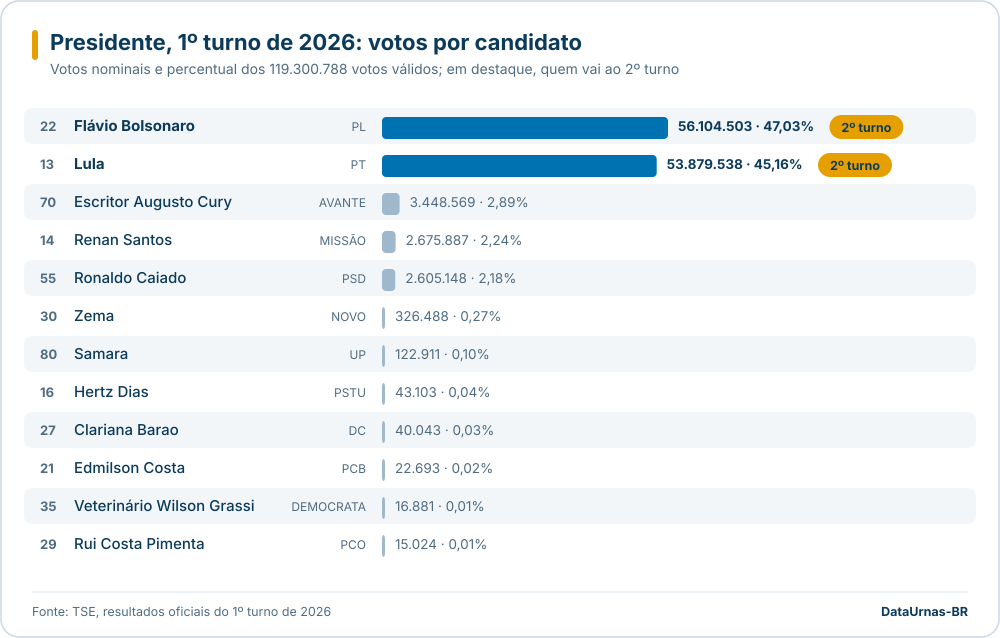
</p>

| Nº | Candidato (nome de urna) | Partido | Votos | % dos válidos | Situação |
|---:|---|---|---:|---:|---|
| 22 | FLÁVIO BOLSONARO | PL | 56.104.503 | 47,03% | 2º turno |
| 13 | LULA | PT | 53.879.538 | 45,16% | 2º turno |
| 70 | ESCRITOR AUGUSTO CURY | AVANTE | 3.448.569 | 2,89% | Não eleito |
| 14 | RENAN SANTOS | MISSÃO | 2.675.887 | 2,24% | Não eleito |
| 55 | RONALDO CAIADO | PSD | 2.605.148 | 2,18% | Não eleito |
| 30 | ZEMA | NOVO | 326.488 | 0,27% | Não eleito |
| 80 | SAMARA | UP | 122.911 | 0,10% | Não eleito |
| 16 | HERTZ DIAS | PSTU | 43.103 | 0,04% | Não eleito |
| 27 | CLARIANA BARAO | DC | 40.043 | 0,03% | Não eleito |
| 21 | EDMILSON COSTA | PCB | 22.693 | 0,02% | Não eleito |
| 35 | VETERINÁRIO WILSON GRASSI | DEMOCRATA | 16.881 | 0,01% | Não eleito |
| 29 | RUI COSTA PIMENTA | PCO | 15.024 | 0,01% | Não eleito |

Os nomes são os de urna publicados pelo TSE, em maiúsculas. O TSE divulga parte deles sem acento; aqui o acento foi restituído apenas onde a grafia do prenome é inequívoca (FLÁVIO). Sobrenomes ficam como registrados.

### Resultado por UF

<p align="center">
  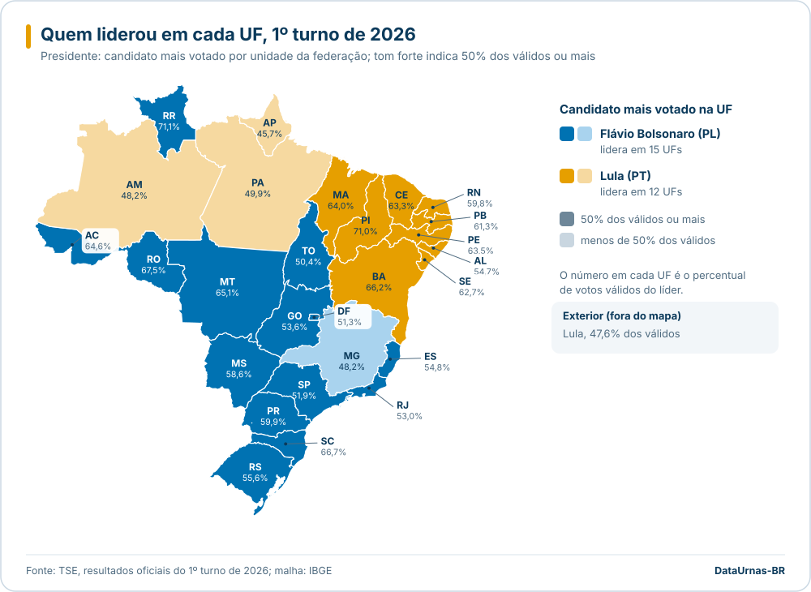
</p>

O tom forte indica que o líder teve 50% ou mais dos votos válidos na UF; o tom claro, menos de 50%. Os votos de cada candidato por UF e por município estão em `resultado_uf.parquet` e `resultado_municipio.parquet`.

### Comparecimento e votos

| Métrica | Valor |
|---|---:|
| Eleitorado apto | 158.745.502 |
| Comparecimento | 125.275.835 (78,92%) |
| Abstenção | 33.469.244 (21,08%) |
| Votos válidos (nominais) | 119.300.788 |
| Votos em branco | 2.300.798 (1,84%) |
| Votos nulos (inclui 5.246 nulos técnicos) | 3.674.249 (2,93%) |
| Seções totalizadas | 499.248 de 499.248 |
| Seções não instaladas | 41 |

Fonte: TSE, [Resultados](https://resultados.tse.jus.br/oficial/), eleição 6257, pleito 3220. Percentuais dos válidos conforme o próprio TSE.

<p align="center">
  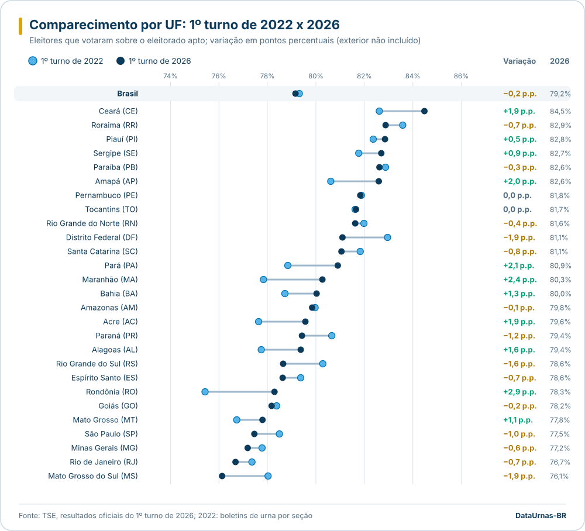
</p>

Na comparação com o 1º turno de 2022 (sem o exterior), o comparecimento ficou praticamente estável: 79,3% em 2022 e 79,2% em 2026. Subiu em 11 UFs, caiu em 14 e variou menos de 0,1 ponto em 2 (Tocantins e Pernambuco). Os números de 2022 vêm dos boletins de urna por seção compilados pelo projeto; os de 2026, dos totais oficiais por UF.

### O que já foi verificado

- A soma dos votos válidos por UF e por município bate exatamente com o total nacional (119.300.788 nas três agregações).
- Os 5.757 municípios (incluindo as cidades do exterior, agrupadas na UF `ZZ`) foram baixados sem nenhuma falha HTTP.
- Os BUs (formato ASN.1 v2, arquivos `-bu.dat`) de todas as 499.207 seções instaladas foram baixados e decodificados, sem nenhuma falha: 502.388 seções processadas, das quais 17.931 agregadas a outra seção e 41 não instaladas no exterior, gerando 3.800.511 linhas de votos.
- A soma dos BUs reproduz **exatamente** o resultado oficial em todas as 28 UFs (27 mais o exterior): votos de cada candidato, brancos, nulos, nulos técnicos e comparecimento (125.275.835 votos). Diferença zero em todos os itens, conferida por `reconcile.py`.
- Modelos de urna identificados pelo arquivo de assinatura: UE2020 (200.463 seções), UE2022 (198.759), UE2015 (88.064) e UE2013 (11.921).

Os esquemas de cada arquivo estão em [docs/dados-2026.md](docs/dados-2026.md).

### Integridade dos arquivos (2026)

#### Integridade dos arquivos: resultado

> **Concluído** em 499.207 de 499.207 seções instaladas (100%), sem erros pendentes. **C01: zero hashes divergentes em 1.497.620 conferidos; zero assinaturas inválidas.**

Cada urna grava, ao encerrar a votação, o BU, o RDV e o log, e assina com a própria chave um arquivo (`.vsc`) que contém o SHA-512 de cada um deles. O projeto recalculou esses SHA-512 a partir dos arquivos que o TSE publica, comparou com os valores assinados, verificou a assinatura de cada urna e comparou os votos do BU assinado com os do BU lido na coleta de resultados. MD5 e SHA-256 também são catalogados, apenas para conferências futuras: não fazem parte do mecanismo da urna.

| Verificação | Resultado |
|---|---:|
| Seções com arquivos verificados | 499.207 (517.179 linhas, incluindo 17.931 agregadas e 41 não instaladas) |
| SHA-512 de BU, RDV e log iguais ao assinado pela urna | 1.497.620 |
| SHA-512 divergentes (C01) | **0** |
| Assinaturas de urna válidas | 499.207 (Ed521: 399.222; ECDSA P-521: 99.985) |
| Assinaturas inválidas | **0** |
| Votos do BU assinado iguais aos do BU coletado | 499.207 |
| RDV assinado pela urna e não publicado | 1 |
| Imagens do BU listadas no `aux.json` e indisponíveis (HTTP 404) | 2.658 |

<p align="center">
  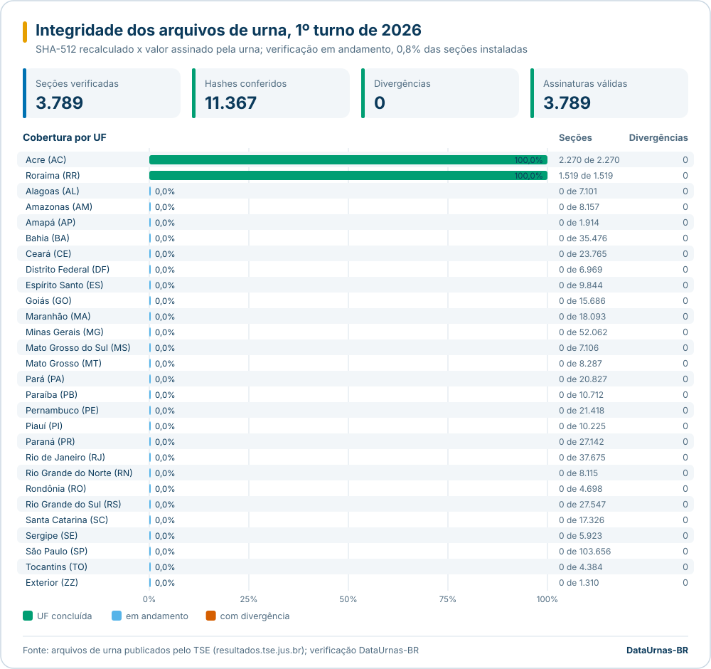
</p>

**Dois pontos de publicação a informar ao TSE**, nenhum deles com divergência de conteúdo:

- **Um RDV não publicado.** Na seção 0228 da zona 0074 de Lagoa Grande do Maranhão (MA, município 07846), o `.vsc` traz o SHA-512 do `rdv.dat`, mas o `aux.json` lista só o log, o `.vsc` e o BU, e o endereço do RDV responde HTTP 404. O BU e o log dessa seção conferem com o que a urna assinou, a assinatura é válida e os votos do BU são os mesmos da coleta. É o único registro de `arquivo_ausente_tse` no país.
- **2.658 imagens do BU indisponíveis.** Em 2.658 seções (PA 1.613, PR 500, MA 403, BA 135, SP 4, RS 2, SC 1), o `aux.json` lista a imagem do BU (`imgbu.dat`) e o servidor responde HTTP 404. Todas estão com status "Recebida" e foram republicadas entre 05 e 07/10/2026; o BU, o RDV e o log delas foram conferidos normalmente. O registro `ocorrencias_publicacao.jsonl` tem 2.677 entradas porque, em 19 seções do PI, a imagem deixou de constar no `aux.json` quando a seção foi verificada de novo (não passou a ser servida). Detalhes na [investigação das seções "Recebida"](docs/investigacao-secoes-recebidas-2026.md).

São lacunas de publicação, não evidência de adulteração. Os pedidos de esclarecimento estão reunidos em [docs/relatorio-tse-ocorrencias-2026.md](docs/relatorio-tse-ocorrencias-2026.md).

**Auditoria do BU e do log (2026), por grupo de leitura.** Concluída em 499.207 seções: 256.306 ocorrências em 159.777 seções. Esta versão foi regerada com o leitor de log corrigido, que lê também o log da urna substituída nas seções com contingência e descarta cópias repetidas do mesmo log; as diferenças em relação à versão anterior estão em `data/parquet/2026/auditoria/comparacao_versao_anterior.json`.

| Grupo | Resultado |
|---|---|
| 1. Indício direto de adulteração | Nenhuma ocorrência de C01, C05, A02 ou A06. Na conferência dos arquivos, 1 registro: o RDV não publicado descrito acima. |
| 2. Inconsistência a investigar | Nenhuma ocorrência de A01. 2 A03 (votos no log diferentes do BU), nas seções em que o pacote publicado não traz o log da urna que recebeu parte dos votos (BA 39934/0183/0175 e SP 71072/0002/0035; ver a [investigação](docs/investigacao-log-bu-2026.md)). 31 M03 (abertura não encontrada no log), todas em seções com BU do sistema de apuração (votação por cédula), cujo log não tem abertura de urna. |
| 3. Operacional ou estatístico | I04 177.616, I03 35.631, C06 28.255 (23.488 de severidade média e 4.767 alta), I05 3.794, I06 3.064, I01 2.902, I02 2.693, A04 1.015, M04 563, M06 533, A05 88, M05 86, M02 33. |

**Certificados das urnas.** Em todas as 499.207 seções: cada modelo tem uma única AC emissora e um único algoritmo (AC URNA com ECDSA P-521 para UE2013 e UE2015; AC UE2020 e AC UE2022 com Ed521 para os modelos de mesmo nome); nenhuma urna aparece com dois certificados e nenhum certificado aparece em urnas diferentes; o CN (`UEAO` + 8 dígitos) segue o padrão em todas. Há 499.179 certificados distintos porque um certificado de urna de apuração do exterior assina 29 BUs do sistema de apuração. O CN é igual ao número interno da urna registrado na carga do BU em 499.193 seções; as 14 restantes, com hash e assinatura válidos, estão listadas no relatório para confirmação com o TSE. A **validação da cadeia** foi **concluída na amostra de 5%, sorteio determinístico** (24.846 seções de todas as UFs, escolhidas pelo SHA-256 da chave da seção): em 24.846 de 24.846 a assinatura do certificado conferiu com a chave da AC emissora e o certificado estava válido no dia da eleição. A cadeia vai **até a AC intermediária**: os certificados das raízes (AC RAIZ UE e AC RAIZ UE v2) e da AC URNA v2 não estão disponíveis publicamente. Os certificados públicos das AC estão em [`data/certificados/`](data/certificados/README.md); os da AC UE2020 e AC UE2022 conferem byte a byte com o SHA-512 publicado pelo TSE. Uma observação a esclarecer com o TSE: o certificado publicado da AC URNA venceu em 18/07/2026, e há certificado de urna emitido em 03/08/2026 que confere com a mesma chave; a explicação mais provável é um certificado renovado da AC URNA, com a mesma chave, que não foi publicado. Não é indício de adulteração.

**Onde ver os detalhes.**

- [Relatório de integridade](docs/relatorio-integridade-2026.md): totais, tabela por UF, divergências com endereços, arquivos indisponíveis, auditoria por código, certificados e o passo a passo para conferir qualquer seção à mão (gerado por `python scripts/docs/gerar_relatorio_integridade.py`).
- [Catálogo de hashes por arquivo](https://github.com/alissonlinneker/DataUrnas-BR/releases/tag/v0.2.1): MD5, SHA-256 e SHA-512 dos 1.999.485 arquivos, um Parquet por UF nos anexos da versão v0.2.1, conferível com `sha256sum -c SHA256SUMS`.
- No painel, a página **Integridade dos arquivos (2026)** permite consultar cada seção.

#### Recontagem voto a voto pelo RDV (2026)

> **Concluída** em 499.207 seções: **o RDV recontado é igual ao BU em 499.206 seções, em todos os cargos; nenhuma divergência.** A seção restante é a do RDV não publicado pelo TSE (Lagoa Grande do Maranhão).

O Registro Digital do Voto (RDV) guarda cada voto digitado na urna, embaralhado e sem identificação do eleitor. O projeto decodifica o RDV de cada seção (`spec/v2/rdv.asn1`), reconta os registros por cargo (voto nominal pelo número digitado, voto de legenda pelos dois primeiros dígitos, brancos e nulos, inclusive os registrados após suspensão da votação) e compara com o BU do mesmo pacote: votos de cada candidato e legenda, brancos, nulos e o número de registros, que deve ser igual ao comparecimento vezes o número de escolhas do cargo. Antes da recontagem, o SHA-512 de cada arquivo baixado é conferido com o catálogo de integridade.

| Cargo | Seções | Conferem | Divergem | Registros no RDV | Votos no BU |
|---|---:|---:|---:|---:|---:|
| Presidente | 499.206 | 499.206 | 0 | 125.275.616 | 125.275.616 |
| Governador | 497.896 | 497.896 | 0 | 124.768.266 | 124.768.266 |
| Senador (2 vagas) | 497.896 | 497.896 | 0 | 249.536.532 | 249.536.532 |
| Deputado Federal | 497.896 | 497.896 | 0 | 124.768.266 | 124.768.266 |
| Deputado Estadual | 490.927 | 490.927 | 0 | 122.950.345 | 122.950.345 |
| Deputado Distrital | 6.969 | 6.969 | 0 | 1.817.921 | 1.817.921 |
| Eleição 6261 (cargo 25) | 10 | 10 | 0 | 2.445 | 2.445 |

Nas seções cujo BU foi digitado no Sistema de Apuração (votação por cédula, inclusive os boletins do exterior apurados no SA), o RDV é gerado pelo próprio sistema a partir dos dados digitados; ali, RDV igual ao BU confirma a coerência do pacote, mas não é uma conferência independente do voto. Nessas seções o RDV pode trazer a eleição em blocos repetidos, um por urna ou mídia, que são somados antes da comparação.

**Log contra BU, voto a voto no tempo.** No mesmo download, o log de cada seção é lido por inteiro (inclusive o da urna substituída, nas seções com contingência) e os eventos "O voto do eleitor foi computado" do dia da eleição são comparados com o comparecimento do BU. Em 499.207 seções, o log confere com o BU em todas as seções de urna, exceto 9, que somam 59 votos a menos no log; nenhum voto fora da sequência de abertura e encerramento da urna. Nas 31 seções com BU do Sistema de Apuração a comparação não se aplica, porque o log do SA não registra votos. As 9 seções estão explicadas na [investigação log x BU](docs/investigacao-log-bu-2026.md): em 5 a urna travou logo depois do voto para Presidente sem gravar a linha do voto (o voto foi contado), em 3 o pacote publicado não traz o log da urna que recebeu parte dos votos (encaminhadas ao TSE) e em 1 a urna reiniciou 17 vezes no dia. O resultado não é afetado em nenhuma delas: o RDV recontado é igual ao BU.

Os resultados por seção estão em `data/parquet/2026/rdv/` (`recontagem_secoes.parquet`, `log_tempo_secoes.parquet`, `resumo.json`); o código está em `src/dataurnas/parsers/rdv.py`, `src/dataurnas/analyzer/rdv_recontagem.py` e `scripts/ele2026/fetch_rdv.py`.

#### Confronto com fontes externas

A única fonte pública e independente de boletins de 2026 encontrada é a Totalização Paralela do CMInd, que reúne leituras do QR Code dos BUs impressos nas seções. Em 14/10/2026 ela tinha 38 BUs do 1º turno (MG, RS, SC e SP). Os 38 tiveram a assinatura da própria urna verificada no QR Code e **todos conferem** com os dados do TSE: votos de cada candidato a Presidente, brancos, nulos, comparecimento, aptos, número da urna e código de carga. A amostra é pequena e não aleatória; serve para validar o método, não para concluir sobre o país. Detalhes em [docs/confronto-fontes-externas.md](docs/confronto-fontes-externas.md) e no script `scripts/externo/confrontar_bu_externo.py`.

---

## Eleições 2022: cobertura completa

<p align="center">
  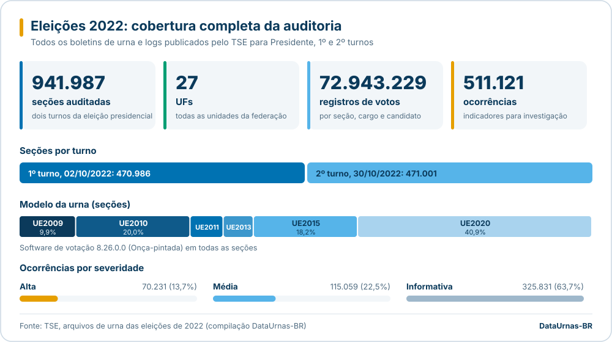
</p>

| Métrica | Valor |
|---|---:|
| Seções eleitorais processadas | 941.987 |
| 1º turno (02/10/2022) | 470.986 seções |
| 2º turno (30/10/2022) | 471.001 seções |
| Linhas de votos por seção, cargo e candidato | 72.943.229 |
| Totais por cargo e seção | 3.074.096 |
| Ocorrências registradas | 511.121 |
| UFs | 27 |
| Modelos de urna | UE2009, UE2010, UE2011, UE2013, UE2015, UE2020 |
| Versão do software de votação | 8.26.0.0 (Onça-pintada) em 941.986 seções; uma seção sem versão registrada |

A maior parte das ocorrências é informativa (proporção elevada de brancos ou nulos, abstenção alta, urna de reserva) ou operacional (reinícios durante a votação, horários). Nenhuma seção de 2022 registrou mais votos que eleitores aptos (C05). **Integridade dos arquivos de 2022.** A base foi compilada sem a conferência de hashes, por ser uma etapa lenta; a conferência foi feita depois, à parte, a partir dos pacotes de dados abertos do TSE lidos por faixas de bytes (`scripts/ele2022/fetch_integridade.py`). Em 944.051 seções dos dois turnos: 3.776.042 SHA-512 iguais ao valor assinado pela urna, **nenhum divergente**; 944.051 assinaturas de urna válidas, **nenhuma inválida**; votos de Presidente do BU assinado iguais aos da base em 941.653 seções, nenhum diferente. A cadeia de certificados foi validada até a AC intermediária numa amostra estratificada de 5% (47.230 seções), sem nenhuma falha. Há 173 arquivos assinados pela urna e ausentes do pacote de dados abertos (64 seções, a maioria do exterior), listados para pedido de esclarecimento ao TSE. Detalhes em [docs/integridade-2022.md](docs/integridade-2022.md); o catálogo de hashes por arquivo está nos anexos da [v0.2.2](https://github.com/alissonlinneker/DataUrnas-BR/releases/tag/v0.2.2). O resultado é registrado em `data/parquet/metadados.parquet` e passa a valer no índice de confiança do painel depois de recompilar o banco (`make build-db`).

### Logs do 2º turno

Os arquivos `.logjez` do 2º turno **acumulam os eventos do 1º turno**: a urna não limpa o log entre os turnos. O parser filtra os eventos pela data do turno (02/10/2022 ou 30/10/2022). Sem esse filtro, 96% das seções do 2º turno exibiriam falsos reinícios, horário de abertura errado e contagem de votos no log duplicada.

---

## Arquitetura

<p align="center">
  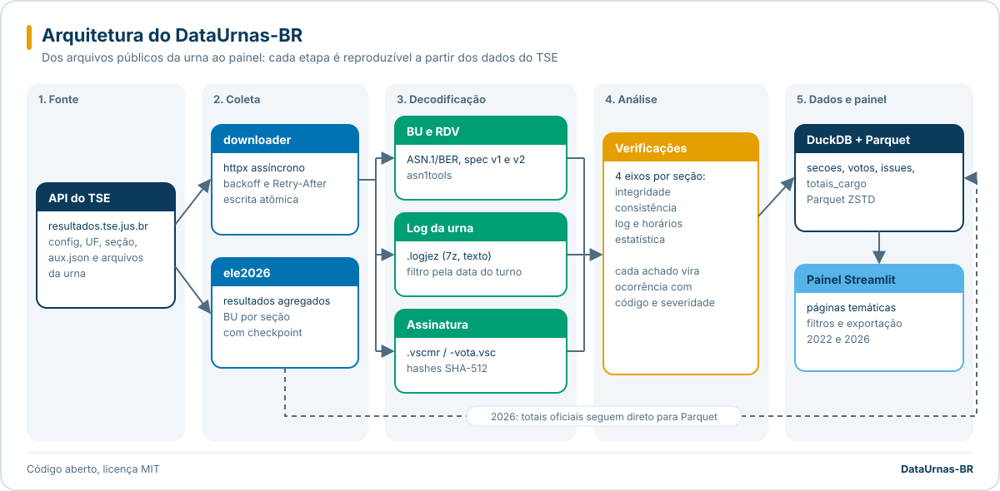
</p>

<details>
<summary>Diagrama detalhado dos módulos (Mermaid)</summary>

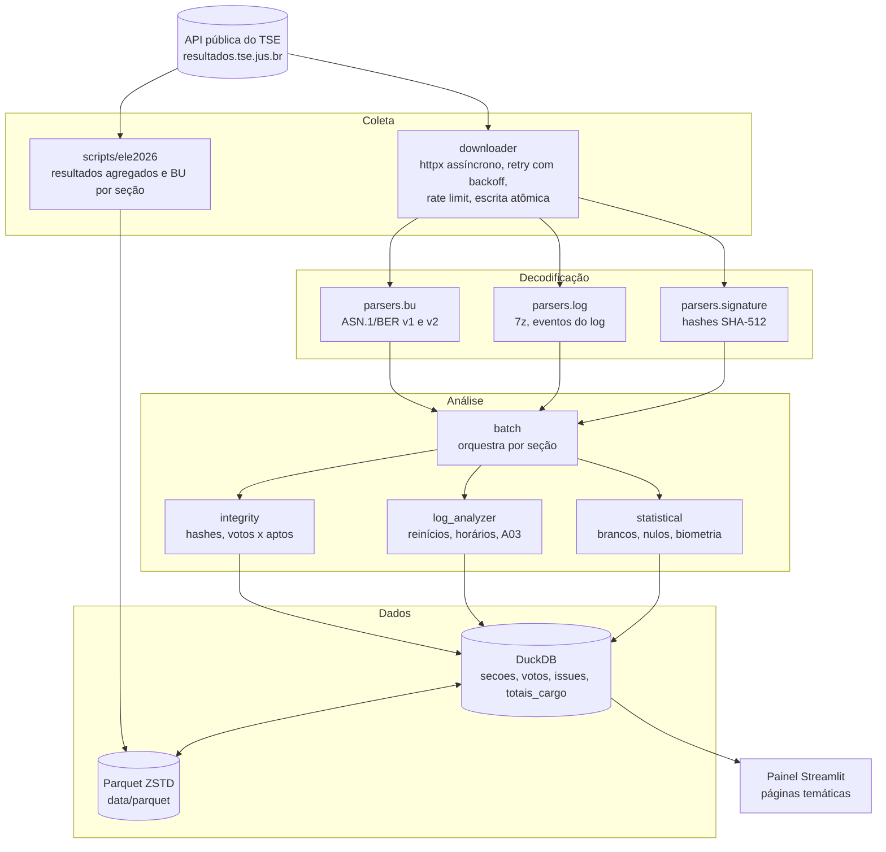

</details>

Mais detalhes em [docs/arquitetura.md](docs/arquitetura.md).

---

## Pipeline

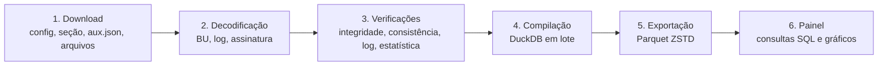

1. **Download.** A API do TSE é hierárquica: configuração da eleição, configuração da UF (municípios, zonas e seções), arquivo auxiliar de cada seção (`aux.json`, com os hashes das urnas) e, por fim, os arquivos da urna. Em 2022 são `.bu`, `.rdv`, `.logjez`, `.imgbu` e `.vscmr`; em 2026 o BU é `-bu.dat` (ou `-busa.dat`, do Sistema de Apuração) e a assinatura é `-vota.vsc`. Em 2026 a coleta baixa apenas o BU e, opcionalmente, a assinatura.
2. **Decodificação.** BU e assinatura são ASN.1/BER, decodificados com `asn1tools` a partir das especificações oficiais em `spec/v1` e `spec/v2`. O log é um arquivo 7z com texto. O RDV e a imagem do BU não são decodificados: as especificações do RDV estão em `spec/` para uso futuro.
3. **Verificações.** Cada seção passa por quatro eixos: integridade, consistência, log e estatística. Cada achado vira uma ocorrência com código, severidade, descrição e base legal.
4. **Compilação.** Os resultados entram no DuckDB em transações por lote.
5. **Exportação.** As tabelas são exportadas para Parquet com compressão ZSTD, que é o formato distribuído no repositório.
6. **Painel.** O painel lê os Parquet, monta o banco na primeira execução e responde às consultas.

---

## Metodologia

Resumo abaixo; a descrição completa, com fórmulas e critérios de cada verificação, está em [docs/metodologia.md](docs/metodologia.md).

| Eixo | O que é verificado |
|---|---|
| Integridade (opcional) | SHA-512 de cada arquivo listado no arquivo de assinatura da urna (o que inclui o RDV e a imagem do BU) comparado com o hash assinado. Arquivo ausente ou ilegível vira E01 (não verificável), nunca C01. Não aplicada na base de 2022 distribuída. |
| Consistência | Votos por cargo não excedem eleitores aptos nem o comparecimento; comparecimento igual entre cargos; eleitores aptos iguais entre as eleições registradas no mesmo BU. |
| Log | Abertura e encerramento no horário legal, ajustado ao fuso da UF; reinícios durante a votação; erros, ajustes de hora, substituições; votos contados no log comparados ao BU. |
| Estatística | Lei de Benford (1º e 2º dígito, qui-quadrado e V de Cramér), outliers por z-score nacional e por UF, nulos e brancos, biometria, duração da votação, comparação entre turnos. |
| Reconciliação | Soma dos BUs por UF comparada com o total oficial do TSE (candidatos, brancos, nulos, comparecimento e número de seções). |

O painel também calcula um **índice de confiança de 0 a 100**, média ponderada de sete componentes (integridade de hash, votos acima do eleitorado, Benford, impacto de reinícios, consistência entre turnos, concentração de outliers e biometria). Na base de 2022 distribuída, compilada antes da conferência de hashes, o componente de integridade aparece como "não verificado" até o banco ser recompilado com o registro da conferência feita à parte (nenhum hash divergente). O índice resume os indicadores do projeto; ele não substitui nem contesta a totalização oficial.

### Fusos horários

Os horários do log são locais, e a votação segue o horário de Brasília (8h às 17h). A análise de horário legal converte esses limites para o fuso de cada seção:

| Região | Fuso | Diferença para Brasília |
|---|---|---:|
| AC | UTC-5 | -2 h |
| AM, MT, MS, RO e RR | UTC-4 | -1 h |
| Demais UFs | UTC-3 | 0 |
| Oeste do Amazonas: Atalaia do Norte, Benjamin Constant, Eirunepé, Envira, Guajará, Ipixuna e Tabatinga | UTC-5 | -2 h |
| Fernando de Noronha (PE) | UTC-2 | +1 h |

As exceções municipais ficam em `src/dataurnas/analyzer/timezones.py` e são resolvidas pelo código TSE do município, com a UF como alternativa. A base de 2022 distribuída foi compilada antes dessas exceções e usa o fuso da UF para todas as seções; elas passam a valer numa recompilação a partir dos dados brutos.

---

## Códigos de inconsistência

Cada código é classificado em um de três **grupos de leitura**, conforme o que ele pode dizer sobre manipulação. A severidade continua indicando a prioridade de investigar; o grupo indica que tipo de conclusão o achado admite. A classificação tem uma fonte única, `src/dataurnas/dashboard/reference.py` (`GRUPOS` e `ISSUE_CATALOGO`), e aparece no painel em todas as listas de ocorrências, com filtro próprio e um resumo de três quadros no veredicto e na página de 2026.

A letra do código indica a família do achado (C, A, M e I por gravidade; E para falhas de verificação). A severidade abaixo é a atribuída pelo código em `src/dataurnas/analyzer/`; a efetiva fica registrada em cada ocorrência. Os limites de horário são do horário de Brasília convertidos para o fuso local da seção.

| Grupo | O que significa |
|---|---|
| 1. Indício direto de adulteração | Não deveria ocorrer num sistema íntegro. Uma única ocorrência exige explicação. |
| 2. Inconsistência a investigar | Tem explicações legítimas conhecidas e só ganha sentido com o contexto da seção. |
| 3. Operacional ou estatístico | Descreve como o dia de votação transcorreu. Sozinho, não é evidência de manipulação. |

### 1. Indício direto de adulteração

| Código | Severidade | Regra | Referência registrada |
|---|---|---|---|
| C01 | Crítica | Hash SHA-512 de um arquivo diverge do hash assinado | Art. 59, Lei 9.504/97; Cerimônia de Lacração |
| C05 | Crítica | Votos de um cargo excedem os eleitores aptos da seção | Art. 59, Lei 9.504/97 |
| A02 | Alta | Votos computados de um cargo excedem o comparecimento | Integridade da contagem |
| A06 | Alta | Comparecimento diferente entre cargos da mesma eleição na seção | Eleitor vota em todos os cargos na mesma sessão |

Na auditoria de integridade de 2026 (arquivos publicados conferidos com o `.vsc` de cada urna), entram neste grupo as categorias `hash_diverge` (SHA-512 diferente do assinado, equivalente ao C01), `assinatura_invalida` (assinatura da urna inválida), `hash_assinado_ausente` (BU, RDV ou log publicado sem hash assinado) e `arquivo_ausente_tse` (arquivo assinado pela urna que não aparece na publicação).

### 2. Inconsistência a investigar

| Código | Severidade | Regra | Referência registrada | Explicação legítima conhecida |
|---|---|---|---|---|
| A01 | Alta | Eleitores aptos diferentes entre as eleições registradas no mesmo BU, já descontado o voto em trânsito | Caderno de eleitores único por seção | Sem o desconto do trânsito, explicava as 30.572 ocorrências de 2022 |
| A03 | Alta | Votos registrados no log divergem do comparecimento do BU em mais de 2 | Consistência interna | Troca de urna divide o log entre equipamentos |
| E02 | Média | BU não decodificável (por exemplo, tipo de voto ausente ou desconhecido); a seção é excluída dos totais | | Arquivo corrompido, formato novo ou limitação do decodificador |
| E03 | Informativa | Duração negativa no log: encerramento registrado antes da abertura | | Ajuste de relógio ou log de outra urna da seção |
| M03 | Média | Log com mais de 100 entradas e sem evento de abertura | | Log incompleto ou de urna substituída |

Em 2026 entra aqui também `votos_divergem`: os votos do BU assinado não conferem com os do BU lido na coleta de resultados. São duas leituras do mesmo boletim, e a diferença pode vir de uma versão republicada ou de contingência.

### 3. Operacional ou estatístico

| Código | Severidade | Regra | Referência registrada |
|---|---|---|---|
| C06 | Média (1 reinício) ou alta (2 ou mais) | Reinício da urna durante a votação | Procedimento de contingência |
| A04 | Alta | Abertura depois das 8h30 (tolerância de 30 min) | Art. 144 do Código Eleitoral (na base de 2022 consta "Art. 59, Lei 9.504/97") |
| A05 | Alta | Encerramento antes das 17h | Art. 153, Código Eleitoral |
| M01 | Média | Abertura antes das 7h, mais de 1 h antes do horário oficial | Art. 144 do Código Eleitoral |
| M02 | Média | Encerramento depois das 22h | |
| M04 | Média | Mais de 10 erros no log | |
| M05 | Média | Ajustes de hora registrados no log | Integridade da linha do tempo de eventos |
| M06 | Média | Mais de 30% dos eleitores liberados por código, sem biometria | Resolução TSE 23.669/2021 |
| I01 | Informativa | Eventos de substituição ou contingência no log | |
| I02 | Informativa | Mais de 20 alertas de mesário | |
| I03 | Informativa | Nulos acima de 15% dos votos de um cargo | |
| I04 | Informativa | Brancos acima de 10% dos votos de um cargo | |
| I05 | Informativa | Abstenção acima de 40% | |
| I06 | Informativa | Urna de reserva ou tipo diferente de seção | |
| E01 | Informativa | Assinatura ou arquivo assinado não verificável (ausente ou ilegível); não é evidência de adulteração | |

Abertura tardia, encerramento antecipado e reinícios afetam o acesso ao voto ou o andamento da seção, não a contagem dos votos registrados. As análises agregadas do painel (Lei de Benford e outliers estatísticos) também pertencem a este grupo: votos por seção não seguem Benford por natureza e seções atípicas existem em qualquer eleição, de modo que os dois testes têm alta taxa de falso positivo em dados eleitorais.

### O que os arquivos públicos permitem detectar

Os arquivos que o TSE publica permitem conferir se o que foi publicado é o que a urna assinou (hash e assinatura), se cada BU é coerente por dentro (aptos, comparecimento e votos) e se a soma dos BUs reproduz a totalização oficial. Uma alteração feita depois da assinatura, no caminho até a publicação ou na totalização, aparece no grupo 1 ou na reconciliação.

Esses arquivos não alcançam uma manipulação feita dentro da urna antes da assinatura, porque nesse caso o BU, o RDV e o log já nasceriam coerentes entre si e corretamente assinados. Essa hipótese é tratada por outros mecanismos, fora do alcance deste projeto: a inspeção do código-fonte pelas entidades fiscalizadoras, a cerimônia de assinatura digital e lacração dos sistemas, o teste de integridade das urnas no dia da eleição e o Teste Público de Segurança. A conferência voto a voto do RDV com o BU de cada seção está no [roadmap](#status-do-projeto-e-roadmap).

### O que não é inconsistência

- Nomes de eleitores no log: comportamento documentado do display do terminal do mesário.
- Urna substituída: procedimento normal de contingência (mais de um hash no `aux.json`).
- Ajuste de hora antes da abertura da votação.
- Abstenção, votos brancos e nulos: direitos do eleitor.

---

## Painel interativo

O painel é uma aplicação Streamlit com várias páginas. A página inicial apresenta o resultado do 1º turno de 2026:

<table>
  <tr>
    <td width="76%" valign="top">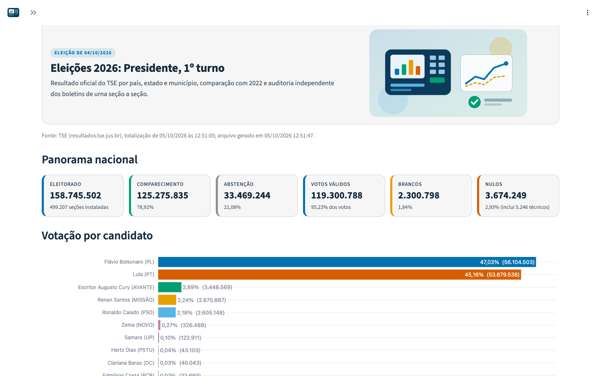</td>
    <td width="24%" valign="top">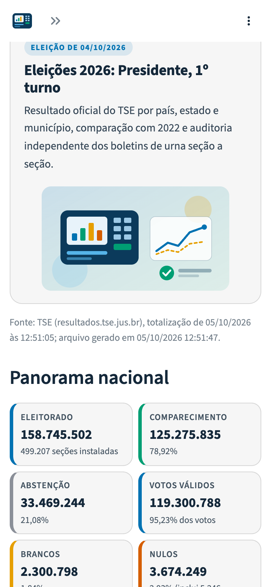</td>
  </tr>
  <tr>
    <td align="center"><sub>Computador (1440 x 900)</sub></td>
    <td align="center"><sub>Celular (390 x 844)</sub></td>
  </tr>
</table>

No mesmo grupo, a página **Integridade dos arquivos (2026)** mostra a conferência de hashes e assinaturas por UF, as divergências, a consulta de qualquer seção (MD5, SHA-256 e SHA-512 calculado e assinado, certificado da urna) e a exportação do catálogo em CSV.

As demais páginas cobrem a auditoria de 2022:

<table>
  <tr>
    <td width="50%" valign="top">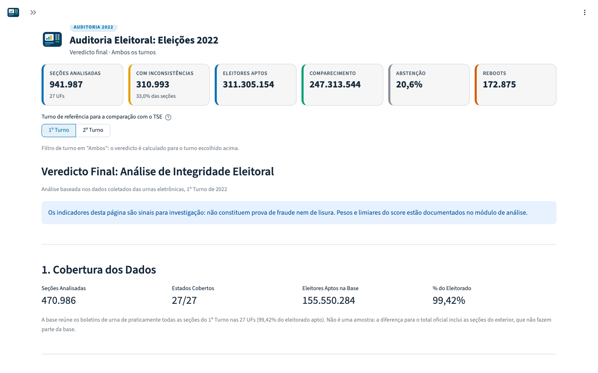</td>
    <td width="50%" valign="top">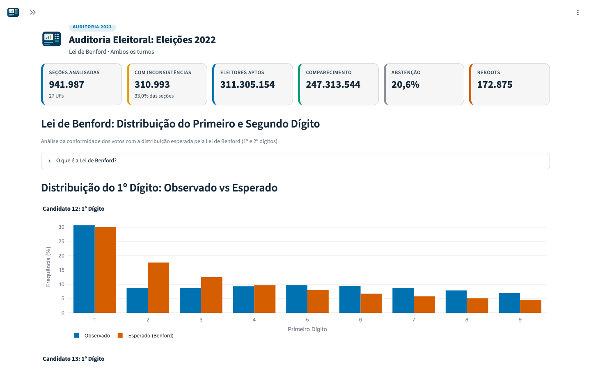</td>
  </tr>
  <tr>
    <td align="center"><sub>Veredicto final</sub></td>
    <td align="center"><sub>Lei de Benford</sub></td>
  </tr>
</table>

Entre as páginas de 2022 estão:

- veredicto e índice de confiança, votação por candidato e cargo, mapa por UF;
- Lei de Benford, outliers, nulos e brancos;
- reinícios, comparação entre turnos, divergência log x BU (A03), biometria, horários, modelos de urna, seções de reserva;
- integridade de hash, explorador de seção, inconsistências por código e por UF.

Os filtros cobrem turno, região, UF, município, modelo e tipo de urna, severidade e código da ocorrência. Os dados podem ser exportados em Excel ou texto.

---

## Instalação

Requisitos: Python 3.11 ou superior e cerca de 3,5 GB livres (Parquet mais o DuckDB gerado).

```bash
git clone https://github.com/alissonlinneker/DataUrnas-BR.git
cd DataUrnas-BR
python -m venv .venv
source .venv/bin/activate          # Windows: .venv\Scripts\activate
pip install -e ".[dashboard,dev]"
```

Com `make`, o mesmo resultado sai de `make install`, que cria o `.venv` se ele não existir. Para apenas executar o painel, `pip install -r requirements.txt` seguido de `pip install --no-deps -e .` também funciona.

---

## Uso

### Atalhos com make

O `Makefile` reúne as tarefas mais comuns e usa o Python do `.venv`. `make help` lista todos os alvos.

| Alvo | O que faz |
|---|---|
| `make install` | Cria o `.venv`, se preciso, e instala o pacote em modo editável com painel e ferramentas de desenvolvimento |
| `make lint` | Roda o `ruff check .` |
| `make test` / `make test-cov` | Roda a suíte de testes, sem ou com relatório de cobertura |
| `make build-db` | Reconstrói o DuckDB a partir dos Parquet de `data/parquet` |
| `make dashboard` | Inicia o painel em `http://localhost:8501` (outra porta com `PORT=8502`) |
| `make fetch-2026` | Baixa o resultado oficial agregado e os BUs de 2026 por seção (`fetch-2026-resultados` + `fetch-2026-secoes`) |
| `make consolidate-2026` | Só consolida em Parquet as partes de 2026 já coletadas |
| `make reconcile-2026` | Compara a soma dos BUs de 2026 com o resultado oficial de cada UF |
| `make docker-build` / `make docker-run` | Constrói e roda a imagem Docker do painel em `http://localhost:7860` |
| `make clean` | Remove caches de build, testes e lint |

Variáveis aceitas na linha de comando: `VENV` (padrão `.venv`), `PORT` (padrão 8501), `UFS` para limitar a coleta e a reconciliação de 2026 (por exemplo, `make reconcile-2026 UFS=ac,rr`) e `IMAGE` (padrão `dataurnas-br`).

### Painel

```bash
python scripts/build_db.py          # cria data/db/eleicoes_2022.duckdb a partir dos Parquet
dataurnas dashboard                 # ou: streamlit run src/dataurnas/dashboard/app.py
```

Acesse `http://localhost:8501`. Se o banco ainda não existir, o painel o constrói na primeira execução.

### Linha de comando

```bash
# Download (API do TSE)
dataurnas download list                                  # eleições disponíveis
dataurnas download info df                               # municípios e seções de uma UF
dataurnas download state df --max-secoes 50 --tipo bu --tipo logjez
dataurnas download sample --estados ac,df,rs --secoes 20

# Análise de arquivos e seções
dataurnas analyze bu caminho/arquivo.bu
dataurnas analyze log caminho/arquivo.logjez
dataurnas analyze hashes caminho/da/secao
dataurnas analyze section caminho/da/secao
dataurnas analyze batch --uf df --hashes -o resultado.json

# Banco de dados
dataurnas db build [--incremental] [--batch-size 500]
dataurnas db stats
```

Use `dataurnas --help` ou `dataurnas <comando> --help` para todas as opções. O download completo de 2022 ocupa cerca de 181 GB.

Concorrência e taxa de requisições do downloader têm padrão conservador e podem ser ajustadas por ambiente:

| Variável | Padrão | Efeito |
|---|---:|---|
| `DATAURNAS_MAX_CONCURRENT` | 50 | Downloads simultâneos |
| `DATAURNAS_RATE_LIMIT` | 200 | Requisições por segundo |

### Eleições 2026

```bash
python scripts/ele2026/fetch_resultados.py               # BR, UFs e municípios (Presidente, 1º turno)
python scripts/ele2026/fetch_secoes.py --ufs ac          # BU por seção, com checkpoint e retomada
python scripts/ele2026/fetch_secoes.py --so-consolidar   # consolida as partes em Parquet
python scripts/ele2026/reconcile.py --ufs ac             # soma dos BUs x resultado oficial da UF
```

`reconcile.py` termina com código 1 quando encontra divergência.

### Testes e qualidade

```bash
ruff check .        # ou: make lint
pytest -q           # ou: make test
```

Os testes usam fixtures sintéticas e não dependem dos dados brutos.

---

## Deploy

O painel roda no [Hugging Face Spaces](https://huggingface.co/spaces/alissonlinneker/dataurnas-br) com o SDK Docker. O `Dockerfile` instala as dependências, copia código, especificações e Parquet, constrói o DuckDB durante o build e expõe a porta 7860.

O workflow `.github/workflows/deploy-hf.yml` roda a CI e, se ela passar, publica cada push na `main` no Space, com os Parquet em Git LFS. Configuração única no GitHub (**Settings > Secrets and variables > Actions**):

- secret `HF_TOKEN` (token de escrita do Hugging Face);
- variables `HF_USERNAME` e `SPACE_NAME`.

Para rodar a imagem localmente:

```bash
docker build -t dataurnas-br .
docker run --rm -p 7860:7860 dataurnas-br
```

---

## Estrutura do projeto

```
DataUrnas-BR/
├── Makefile                   # Atalhos: install, lint, test, build-db, dashboard, 2026, Docker
├── Dockerfile                 # Imagem do painel (Hugging Face Spaces)
├── data/parquet/              # Dados distribuídos (2022 na raiz, 2026 em 2026/)
├── docs/
│   ├── README.md              # Índice da documentação
│   ├── metodologia.md         # Verificações, códigos, limiares e índice de confiança
│   ├── arquitetura.md         # Módulos, fluxo de uma seção, banco e deploy
│   ├── dados-2026.md          # Arquivos e esquemas de 2026
│   ├── faq.md                 # Perguntas frequentes
│   └── assets/                # Banner, gráficos SVG e telas/ (capturas do painel)
├── spec/v1, spec/v2           # Especificações ASN.1 oficiais (2022 e 2024 em diante)
├── scripts/
│   ├── build_db.py            # Constrói o DuckDB a partir dos Parquet
│   ├── download_*.py          # Downloads completos de 2022
│   ├── rebuild_*.py           # Recompilação a partir dos dados brutos
│   ├── ele2026/               # Coleta e reconciliação de 2026
│   └── docs/                  # Geração das ilustrações e capturas de tela do README
├── src/dataurnas/
│   ├── cli.py                 # Interface de linha de comando (Click)
│   ├── config.py              # Constantes: API, UFs, eleições
│   ├── models.py              # Modelos de domínio
│   ├── downloader/            # Cliente HTTP, navegação da API, orquestração
│   ├── parsers/               # BU, log e assinatura
│   ├── analyzer/              # Integridade, log, estatística, lote, fusos
│   ├── database/              # DuckDB e montagem de linhas
│   └── dashboard/             # Painel Streamlit (páginas, componentes, análises SQL)
└── tests/                     # Testes com fixtures sintéticas (sem dados brutos)
```

---

## Documentação

| Documento | Conteúdo |
|---|---|
| [docs/README.md](docs/README.md) | Índice de toda a documentação |
| [Metodologia](docs/metodologia.md) | Arquivos da urna, verificações, códigos com severidade e limiares, índice de confiança e reconciliação de 2026 |
| [Arquitetura](docs/arquitetura.md) | Módulos, scripts, fluxo de uma seção, banco de dados e deploy |
| [Dados de 2026](docs/dados-2026.md) | Arquivos Parquet de 2026, forma de coleta, totais oficiais, nulos técnicos e esquemas |
| [Perguntas frequentes](docs/faq.md) | O que o projeto prova e não prova, como reproduzir, BU x RDV, nulos técnicos e cobertura |
| [Relatório de integridade de 2026](docs/relatorio-integridade-2026.md) | Hashes, assinaturas, auditoria por grupo de leitura, certificados e conferência manual de uma seção |
| [Investigação das seções "Recebida"](docs/investigacao-secoes-recebidas-2026.md) | Seções republicadas entre 05 e 07/10/2026 e imagens do BU indisponíveis |
| [Integridade de 2022](docs/integridade-2022.md) | Hashes, assinaturas e cadeia de certificados de 2022 (1º e 2º turnos) e arquivos assinados ausentes do pacote do TSE |
| [Investigação log x BU (2026)](docs/investigacao-log-bu-2026.md) | Seções em que a contagem de votos no log difere do BU: causas, correções do leitor e casos encaminhados ao TSE |
| [Confronto com fontes externas](docs/confronto-fontes-externas.md) | BUs do TSE confrontados com leituras independentes do QR Code dos boletins impressos |
| [Ocorrências para o TSE](docs/relatorio-tse-ocorrencias-2026.md) | Pontos de publicação, de certificação e de log a esclarecer com o TSE |

---

## Fontes de dados e legislação

### Fontes

- [Resultados do TSE](https://resultados.tse.jus.br/oficial/): arquivos de urna e resultados agregados.
- [Portal de Dados Abertos do TSE](https://dadosabertos.tse.jus.br/): dados complementares.
- [Segurança da urna eletrônica](https://www.tse.jus.br/eleicoes/urna-eletronica/seguranca-da-urna): documentação dos formatos e mecanismos de auditoria.

### Legislação

| Norma | Aspecto |
|---|---|
| Lei 9.504/1997, art. 59 | Votação eletrônica e assinatura digital dos arquivos |
| Lei 9.504/1997, art. 59-A | Auditoria e fiscalização dos sistemas |
| Lei 9.504/1997, art. 66 | Fiscalização por partidos e coligações |
| Lei 10.740/2003 | Registro Digital do Voto |
| Código Eleitoral, art. 153 | Encerramento da votação |
| Resolução TSE 23.673/2021 | Fiscalização e auditoria do sistema eletrônico |

---

## Limitações

- O projeto trabalha **somente com os arquivos públicos**. Ele não tem acesso às urnas, ao código-fonte compilado nem às chaves privadas. Em 2026 a cadeia de certificados das urnas é conferida até a AC intermediária (AC URNA, AC UE2020 e AC UE2022), não até a raiz, cujos certificados não estão publicados; a assinatura de software (CEPESC) usa algoritmo não publicado e não é verificada.
- Uma ocorrência é um **indicador para investigação**, não uma conclusão. Reinícios, horários e proporções atípicas costumam ter explicação operacional.
- Testes estatísticos como Benford têm alcance limitado em dados eleitorais, cuja distribuição depende do tamanho das seções. Por isso o projeto usa medidas de efeito (V de Cramér) além do p-valor.
- Em 2026, a validação da cadeia de certificados foi feita numa amostra determinística de 5% das seções; a coerência dos certificados (unicidade, CN e emissor por modelo) cobre todas. Arquivos que o TSE não publica (um RDV e 2.658 imagens do BU listadas e indisponíveis) não puderam ser conferidos.
- Seções cujo BU não pôde ser decodificado (E02) ficam fora dos totais e são listadas para conferência.
- A base de 2022 foi compilada sem conferência de hashes, feita depois à parte (nenhum divergente); o componente de integridade do índice de confiança só passa a refleti-la depois de recompilar o banco. Em 2022 a cadeia de certificados foi validada numa amostra de 5% e o RDV não é recontado.
- Em 2026 o RDV é decodificado e recontado em todas as seções; nas seções apuradas no Sistema de Apuração o RDV é gerado pelo próprio sistema, e a conferência com o BU não é independente. Em 2022 o RDV ainda não é recontado. A imagem do BU é baixada e tem o hash conferido, mas não é decodificada.
- Os códigos E01, E02 e E03 e as exceções de fuso por município foram introduzidos na versão 0.2.0; os Parquet de 2022 distribuídos foram compilados antes deles e só passam a refleti-los após uma recompilação a partir dos dados brutos.

---

## Status do projeto e roadmap

| Item | Situação |
|---|---|
| 2022, Presidente, 1º e 2º turnos: BU, log e assinatura por seção | Concluído |
| 2026, Presidente, 1º turno: resultado oficial agregado (Brasil, UFs, exterior e municípios) | Concluído |
| 2026, Presidente, 1º turno: BU por seção e reconciliação com o oficial | Concluído (diferença zero nas 28 UFs) |
| 2026, 1º turno: integridade dos arquivos (SHA-512 e assinatura de cada urna) | Concluído (0 divergentes em 1.497.620; 0 assinaturas inválidas) |
| 2026, 1º turno: auditoria do BU e do log por grupo de leitura | Concluído (nenhuma ocorrência do grupo 1) |
| 2026, 1º turno: coerência dos certificados das urnas | Concluído (todas as seções) |
| 2026, 1º turno: validação da cadeia de certificados até a AC intermediária | Concluído na amostra de 5%, sorteio determinístico |
| 2026, 1º turno: catálogo de hashes por arquivo | Publicado nos anexos da [v0.2.1](https://github.com/alissonlinneker/DataUrnas-BR/releases/tag/v0.2.1) |
| 2022, 1º e 2º turnos: integridade dos arquivos (SHA-512 e assinatura de cada urna) | Concluído (0 divergentes em 3.776.042; 0 assinaturas inválidas) |
| 2022: validação da cadeia de certificados até a AC intermediária | Concluído na amostra de 5% (47.230 seções) |
| Cadeia de certificados até a raiz | Depende da publicação dos certificados raiz pelo TSE |
| 2026, Presidente, 2º turno | Planejado |
| 2026, 1º turno: recontagem voto a voto do RDV contra o BU de cada seção | Concluído (0 divergências em 499.206 seções) |
| 2026, 1º turno: confronto com leituras independentes do QR Code (CMInd) | Concluído (38 de 38 conferem) |
| Recontagem pelo RDV em 2022; decodificação da imagem do BU | Futuro |

As mudanças de cada versão ficam no [CHANGELOG](CHANGELOG.md).

---

## Como citar

Use o botão **Cite this repository** do GitHub (gerado a partir de [CITATION.cff](CITATION.cff)) ou:

```bibtex
@software{linneker_dataurnas_br,
  author  = {Linneker, Alisson},
  title   = {DataUrnas-BR: auditoria independente dos arquivos públicos da urna eletrônica},
  year    = {2026},
  version = {0.2.1},
  url     = {https://github.com/alissonlinneker/DataUrnas-BR},
  license = {MIT}
}
```

---

## Contribuindo

Contribuições são bem-vindas. Leia o [guia de contribuição](CONTRIBUTING.md) e o [código de conduta](CODE_OF_CONDUCT.md). Vulnerabilidades devem ser reportadas conforme a [política de segurança](SECURITY.md). As mudanças de cada versão estão no [CHANGELOG](CHANGELOG.md).

### Como regenerar as ilustrações

Os gráficos deste README são SVG gerados a partir dos Parquet em `data/parquet/`, sem bibliotecas de gráficos; as telas do painel são capturadas com o `chrome-headless-shell` do cache do Playwright.

```bash
python scripts/docs/gerar_ilustracoes.py     # docs/assets/*.svg (use --png DIR para conferir em PNG)
python scripts/docs/capturar_telas.py        # docs/assets/telas/*.png (sobe o painel numa porta livre)
```

O segundo script encerra o painel e o navegador ao final e remove os metadados dos PNG. Rode os dois de novo sempre que os dados mudarem.

---

## Licença

[MIT](LICENSE) © 2026 Alisson Linneker. Os dados eleitorais são públicos e pertencem ao TSE.
