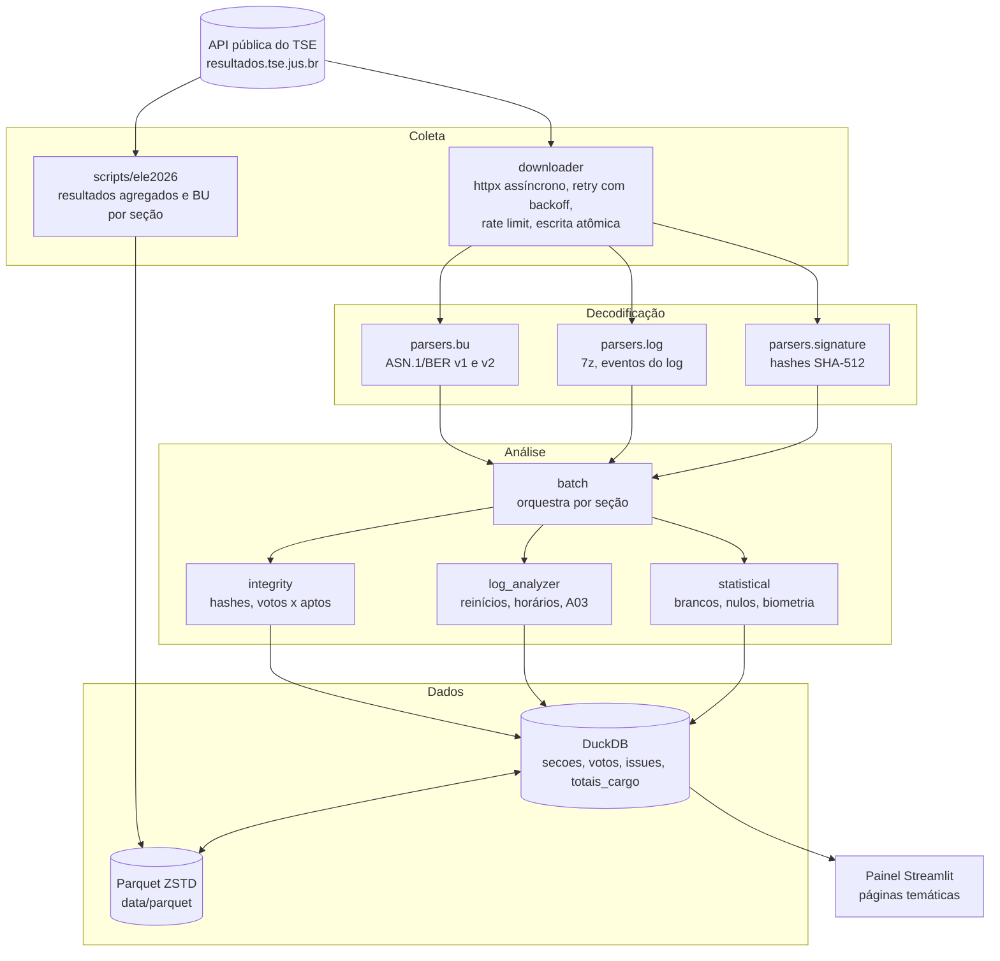
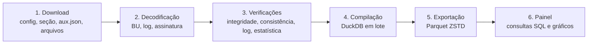

<p align="center">
  
</p>

<p align="center">
  <a href="https://github.com/alissonlinneker/dataUrnas-br/actions/workflows/ci.yml"></a>
  <a href="LICENSE"></a>
  <a href="https://www.python.org/"></a>
  <a href="https://huggingface.co/spaces/alissonlinneker/dataurnas-br"></a>
</p>

# DataUrnas-BR

Auditoria independente e reprodutível dos **arquivos públicos da urna eletrônica brasileira** publicados pelo Tribunal Superior Eleitoral (TSE).

O projeto baixa, decodifica e confere os arquivos que cada urna gera ao fim da votação (Boletim de Urna, Registro Digital do Voto, log, imagem do BU e assinaturas digitais), refaz a totalização a partir dos dados brutos e aplica verificações de integridade criptográfica, consistência lógica, comportamento operacional e padrões estatísticos. Tudo é feito com dados abertos, código aberto e resultados versionados, para que qualquer pessoa possa repetir o processo e chegar aos mesmos números.

> **[Abrir o painel online](https://huggingface.co/spaces/alissonlinneker/dataurnas-br)**, sem instalação.

---

## Sumário

- [Destaques](#destaques)
- [Eleições 2026: Presidente, 1º turno](#eleições-2026-presidente-1º-turno)
- [Eleições 2022: cobertura completa](#eleições-2022-cobertura-completa)
- [Arquitetura](#arquitetura)
- [Pipeline](#pipeline)
- [Metodologia](#metodologia)
- [Códigos de inconsistência](#códigos-de-inconsistência)
- [Painel interativo](#painel-interativo)
- [Instalação](#instalação)
- [Uso](#uso)
- [Deploy](#deploy)
- [Estrutura do projeto](#estrutura-do-projeto)
- [Fontes de dados e legislação](#fontes-de-dados-e-legislação)
- [Limitações](#limitações)
- [Como citar](#como-citar)
- [Contribuindo](#contribuindo)
- [Licença](#licença)

---

## Destaques

- **2022 completo:** 941.987 seções dos dois turnos da eleição presidencial, em todas as 27 UFs, decodificadas e auditadas.
- **2026 em andamento:** resultado oficial agregado do 1º turno de Presidente (Brasil, 27 UFs, exterior e 5.757 municípios) já incorporado; a coleta seção a seção dos Boletins de Urna está em curso.
- **Totalização paralela:** os votos são somados a partir dos BUs e reconciliados com os totais oficiais, UF por UF.
- **Verificação criptográfica:** hashes SHA-512 de cada arquivo conferidos contra o arquivo de assinatura da urna (etapa opcional, ativada com `--hashes`).
- **Dados distribuídos em Parquet (ZSTD):** os 181 GB de arquivos brutos de 2022 viram cerca de 183 MB, prontos para consulta com DuckDB.
- **Painel web** em Streamlit, com filtros por turno, região, UF, município, modelo de urna e severidade.

---

## Eleições 2026: Presidente, 1º turno

Eleição realizada em **04/10/2026**. Os números abaixo são os **totais oficiais do 1º turno divulgados pelo TSE** (totalização de 05/10/2026, 12:51:05), lidos de `data/parquet/2026/resumo_br.json`. Eles são reproduzidos aqui como referência para a reconciliação feita pelo projeto, sem qualquer interpretação política.

### Resultado nacional

| Nº | Candidato (nome de urna) | Partido | Votos | % dos válidos | Situação |
|---:|---|---|---:|---:|---|
| 22 | FLAVIO BOLSONARO | PL | 56.104.503 | 47,03% | 2º turno |
| 13 | LULA | PT | 53.879.538 | 45,16% | 2º turno |
| 70 | ESCRITOR AUGUSTO CURY | AVANTE | 3.448.569 | 2,89% | Não eleito |
| 14 | RENAN SANTOS | MISSÃO | 2.675.887 | 2,24% | Não eleito |
| 55 | RONALDO CAIADO | PSD | 2.605.148 | 2,18% | Não eleito |
| 30 | ZEMA | NOVO | 326.488 | 0,27% | Não eleito |
| 80 | SAMARA | UP | 122.911 | 0,10% | Não eleito |
| 16 | HERTZ DIAS | PSTU | 43.103 | 0,04% | Não eleito |
| 27 | CLARIANA BARAO | DC | 40.043 | 0,03% | Não eleito |
| 21 | EDMILSON COSTA | PCB | 22.693 | 0,02% | Não eleito |
| 35 | VETERINÁRIO WILSON GRASSI | DEMOCRATA | 16.881 | 0,01% | Não eleito |
| 29 | RUI COSTA PIMENTA | PCO | 15.024 | 0,01% | Não eleito |

### Comparecimento e votos

| Métrica | Valor |
|---|---:|
| Eleitorado apto | 158.745.502 |
| Comparecimento | 125.275.835 (78,92%) |
| Abstenção | 33.469.244 (21,08%) |
| Votos válidos (nominais) | 119.300.788 |
| Votos em branco | 2.300.798 (1,84%) |
| Votos nulos (inclui 5.246 nulos técnicos) | 3.674.249 (2,93%) |
| Seções totalizadas | 499.248 de 499.248 |
| Seções não instaladas | 41 |

Fonte: TSE, [Resultados](https://resultados.tse.jus.br/oficial/), eleição 6257, pleito 3220. Percentuais dos válidos conforme o próprio TSE.

### O que já foi verificado

- A soma dos votos válidos por UF e por município bate exatamente com o total nacional (119.300.788 nas três agregações).
- Os 5.757 municípios (incluindo as cidades do exterior, agrupadas na UF `ZZ`) foram baixados sem nenhuma falha HTTP.
- A coleta dos BUs por seção (formato ASN.1 v2, arquivos `-bu.dat`) roda em segundo plano com checkpoint; o script `reconcile.py` confere, para cada UF concluída, se a soma dos BUs reproduz os totais oficiais de candidatos, brancos, nulos e comparecimento.

Os esquemas de cada arquivo estão em [docs/dados-2026.md](docs/dados-2026.md).

---

## Eleições 2022: cobertura completa

| Métrica | Valor |
|---|---:|
| Seções eleitorais processadas | 941.987 |
| 1º turno (02/10/2022) | 470.986 seções |
| 2º turno (30/10/2022) | 471.001 seções |
| Linhas de votos por seção, cargo e candidato | 72.943.229 |
| Totais por cargo e seção | 3.074.096 |
| Ocorrências registradas | 511.121 |
| UFs | 27 |
| Modelos de urna | UE2009, UE2010, UE2011, UE2013, UE2015, UE2020 |
| Versão do software de votação | 8.26.0.0 (Onça-pintada), em todas as seções |

A maior parte das ocorrências é informativa (proporção elevada de brancos ou nulos, abstenção alta, urna de reserva) ou operacional (reinícios durante a votação, horários). Nenhuma seção de 2022 registrou mais votos que eleitores aptos (C05). A conferência de hashes (C01) é opcional por ser lenta (`dataurnas analyze batch --hashes`) e não fez parte da compilação distribuída, por isso o conjunto atual não traz ocorrências desse código.

### Logs do 2º turno

Os arquivos `.logjez` do 2º turno **acumulam os eventos do 1º turno**: a urna não limpa o log entre os turnos. O parser filtra os eventos pela data do turno (02/10/2022 ou 30/10/2022). Sem esse filtro, 96% das seções do 2º turno exibiriam falsos reinícios, horário de abertura errado e contagem de votos no log duplicada.

---

## Arquitetura



Mais detalhes em [docs/arquitetura.md](docs/arquitetura.md).

---

## Pipeline



1. **Download.** A API do TSE é hierárquica: configuração da eleição, configuração da UF (municípios, zonas e seções), arquivo auxiliar de cada seção (`aux.json`, com os hashes das urnas) e, por fim, os arquivos da urna. Em 2022 são `.bu`, `.rdv`, `.logjez`, `.imgbu` e `.vscmr`; em 2026 o BU é `-bu.dat` (ou `-busa.dat`, do Sistema de Apuração) e a assinatura é `-vota.vsc`.
2. **Decodificação.** BU e assinatura são ASN.1/BER, decodificados com `asn1tools` a partir das especificações oficiais em `spec/v1` e `spec/v2`. O log é um arquivo 7z com texto.
3. **Verificações.** Cada seção passa por quatro eixos: integridade, consistência, log e estatística. Cada achado vira uma ocorrência com código, severidade, descrição e base legal.
4. **Compilação.** Os resultados entram no DuckDB em transações por lote.
5. **Exportação.** As tabelas são exportadas para Parquet com compressão ZSTD, que é o formato distribuído no repositório.
6. **Painel.** O painel lê os Parquet, monta o banco na primeira execução e responde às consultas.

---

## Metodologia

Resumo abaixo; a descrição completa, com fórmulas e critérios de cada verificação, está em [docs/metodologia.md](docs/metodologia.md).

| Eixo | O que é verificado |
|---|---|
| Integridade | SHA-512 de cada arquivo comparado com o hash assinado no arquivo de assinatura da urna. Arquivo ausente ou ilegível vira E01 (não verificável), nunca C01. |
| Consistência | Votos por cargo não excedem eleitores aptos nem o comparecimento; comparecimento igual entre cargos; eleitorado da seção estável entre eleições. |
| Log | Abertura e encerramento no horário legal, ajustado ao fuso da UF; reinícios durante a votação; erros, ajustes de hora, substituições; votos contados no log comparados ao BU. |
| Estatística | Lei de Benford (1º e 2º dígito, qui-quadrado e V de Cramér), outliers por z-score nacional e por UF, nulos e brancos, biometria, duração da votação, comparação entre turnos. |
| Reconciliação | Soma dos BUs por UF comparada com o total oficial do TSE (candidatos, brancos, nulos, comparecimento e número de seções). |

O painel também calcula um **índice de confiança de 0 a 100**, média ponderada de sete componentes (integridade de hash, votos acima do eleitorado, Benford, impacto de reinícios, consistência entre turnos, concentração de outliers e biometria). O índice resume os indicadores do projeto; ele não substitui nem contesta a totalização oficial.

### Fusos horários

Os horários do log são locais. A análise de horário legal usa o fuso de cada UF: AC (UTC-5); AM, MT, MS, RO e RR (UTC-4); demais (UTC-3).

---

## Códigos de inconsistência

A letra indica a família do achado; a severidade efetiva é a registrada em cada ocorrência.

### Críticas e altas

| Código | Severidade | Descrição | Referência |
|---|---|---|---|
| C01 | Crítica | Hash SHA-512 do arquivo diverge do hash assinado | Art. 59, Lei 9.504/97; Cerimônia de Lacração |
| C05 | Crítica | Votos de um cargo excedem os eleitores aptos da seção | Art. 59, Lei 9.504/97 |
| C06 | Média (1 reinício) ou Alta (2 ou mais) | Reinício da urna durante a votação | Procedimento de contingência |
| A01 | Alta | Eleitores aptos divergentes entre eleições na mesma urna | Caderno de eleitores único por seção |
| A02 | Alta | Votos computados excedem o comparecimento | Integridade da contagem |
| A03 | Alta | Votos registrados no log divergem do comparecimento do BU em mais de 2 | Consistência interna |
| A04 | Alta | Abertura depois das 8h30 (horário de Brasília convertido para o fuso local) | Art. 59, Lei 9.504/97 |
| A05 | Alta | Encerramento antes das 17h (horário de Brasília convertido para o fuso local) | Art. 153, Código Eleitoral |
| A06 | Alta | Comparecimento divergente entre cargos | Eleitor vota em todos os cargos na mesma sessão |

### Médias

| Código | Descrição |
|---|---|
| M01 | Abertura antes das 8h (ajustada pelo fuso) |
| M02 | Encerramento depois das 22h (ajustado pelo fuso) |
| M03 | Evento de abertura não encontrado no log |
| M04 | Mais de 10 erros no log |
| M05 | Ajustes de hora detectados |
| M06 | Mais de 30% dos eleitores liberados sem biometria |
| E02 | BU não decodificável (por exemplo, tipo de voto desconhecido); a seção é excluída dos totais |

### Informativas

| Código | Descrição |
|---|---|
| I01 | Eventos de substituição ou contingência |
| I02 | Mais de 20 alertas de mesário |
| I03 | Nulos acima de 15% em um cargo |
| I04 | Brancos acima de 10% em um cargo |
| I05 | Abstenção acima de 40% |
| I06 | Urna de reserva ou tipo não padrão |
| E01 | Assinatura não verificável (arquivo ausente ou ilegível); não é evidência de adulteração |
| E03 | Duração negativa no log: encerramento registrado antes da abertura |

### O que não é inconsistência

- Nomes de eleitores no log: comportamento documentado do display do terminal do mesário.
- Urna substituída: procedimento normal de contingência (mais de um hash no `aux.json`).
- Ajuste de hora antes da abertura da votação.
- Abstenção, votos brancos e nulos: direitos do eleitor.

---

## Painel interativo

O painel é uma aplicação Streamlit com várias páginas. A página inicial apresenta o resultado do 1º turno de 2026; as demais páginas cobrem a auditoria de 2022, entre elas:

- veredicto e índice de confiança, votação por candidato e cargo, mapa por UF;
- Lei de Benford, outliers, nulos e brancos;
- reinícios, comparação entre turnos, divergência log x BU (A03), biometria, horários, modelos de urna, seções de reserva;
- integridade de hash, explorador de seção, inconsistências por código e por UF.

Os filtros cobrem turno, região, UF, município, modelo e tipo de urna, severidade e código da ocorrência. Os dados podem ser exportados em Excel ou texto.

---

## Instalação

Requisitos: Python 3.11 ou superior e cerca de 3,5 GB livres (Parquet mais o DuckDB gerado).

```bash
git clone https://github.com/alissonlinneker/dataUrnas-br.git
cd dataUrnas-br
python -m venv .venv
source .venv/bin/activate          # Windows: .venv\Scripts\activate
pip install -e ".[dashboard,dev]"
```

Para apenas executar o painel, `pip install -r requirements.txt` seguido de `pip install --no-deps -e .` também funciona.

---

## Uso

### Painel

```bash
python scripts/build_db.py          # cria data/db/eleicoes_2022.duckdb a partir dos Parquet
dataurnas dashboard                 # ou: streamlit run src/dataurnas/dashboard/app.py
```

Acesse `http://localhost:8501`. Se o banco ainda não existir, o painel o constrói na primeira execução.

### Linha de comando

```bash
# Download (API do TSE)
dataurnas download list                                  # eleições disponíveis
dataurnas download info df                               # municípios e seções de uma UF
dataurnas download state df --max-secoes 50 --tipo bu --tipo logjez
dataurnas download sample --estados ac,df,rs --secoes 20

# Análise de arquivos e seções
dataurnas analyze bu caminho/arquivo.bu
dataurnas analyze log caminho/arquivo.logjez
dataurnas analyze hashes caminho/da/secao
dataurnas analyze section caminho/da/secao
dataurnas analyze batch --uf df --hashes -o resultado.json

# Banco de dados
dataurnas db build [--incremental] [--batch-size 500]
dataurnas db stats
```

Use `dataurnas --help` ou `dataurnas <comando> --help` para todas as opções. O download completo de 2022 ocupa cerca de 181 GB.

Concorrência e taxa de requisições do downloader têm padrão conservador e podem ser ajustadas por ambiente:

| Variável | Padrão | Efeito |
|---|---:|---|
| `DATAURNAS_MAX_CONCURRENT` | 50 | Downloads simultâneos |
| `DATAURNAS_RATE_LIMIT` | 200 | Requisições por segundo |

### Eleições 2026

```bash
python scripts/ele2026/fetch_resultados.py               # BR, UFs e municípios (Presidente, 1º turno)
python scripts/ele2026/fetch_secoes.py --ufs ac          # BU por seção, com checkpoint e retomada
python scripts/ele2026/fetch_secoes.py --so-consolidar   # consolida as partes em Parquet
python scripts/ele2026/reconcile.py --ufs ac             # soma dos BUs x resultado oficial da UF
```

`reconcile.py` termina com código 1 quando encontra divergência.

### Testes e qualidade

```bash
ruff check .
pytest -q
```

---

## Deploy

O painel roda no [Hugging Face Spaces](https://huggingface.co/spaces/alissonlinneker/dataurnas-br) com o SDK Docker. O `Dockerfile` instala as dependências, copia código, especificações e Parquet, constrói o DuckDB durante o build e expõe a porta 7860.

O workflow `.github/workflows/deploy-hf.yml` roda a CI e, se ela passar, publica cada push na `main` no Space, com os Parquet em Git LFS. Configuração única no GitHub (**Settings > Secrets and variables > Actions**):

- secret `HF_TOKEN` (token de escrita do Hugging Face);
- variables `HF_USERNAME` e `SPACE_NAME`.

Para rodar a imagem localmente:

```bash
docker build -t dataurnas-br .
docker run --rm -p 7860:7860 dataurnas-br
```

---

## Estrutura do projeto

```
dataUrnas-br/
├── data/parquet/              # Dados distribuídos (2022 na raiz, 2026 em 2026/)
├── docs/                      # Metodologia, arquitetura, dados de 2026 e imagens
├── spec/v1, spec/v2           # Especificações ASN.1 oficiais (2022 e 2024+)
├── scripts/
│   ├── build_db.py            # Constrói o DuckDB a partir dos Parquet
│   ├── download_*.py          # Downloads completos de 2022
│   ├── rebuild_*.py           # Recompilação a partir dos dados brutos
│   └── ele2026/               # Coleta e reconciliação de 2026
├── src/dataurnas/
│   ├── cli.py                 # Interface de linha de comando (Click)
│   ├── config.py              # Constantes: API, UFs, eleições
│   ├── models.py              # Modelos de domínio
│   ├── downloader/            # Cliente HTTP, navegação da API, orquestração
│   ├── parsers/               # BU, log e assinatura
│   ├── analyzer/              # Integridade, log, estatística, lote, fusos
│   ├── database/              # DuckDB e montagem de linhas
│   └── dashboard/             # Painel Streamlit (páginas, componentes, análises SQL)
└── tests/                     # Testes com fixtures sintéticas (sem dados brutos)
```

---

## Fontes de dados e legislação

### Fontes

- [Resultados do TSE](https://resultados.tse.jus.br/oficial/): arquivos de urna e resultados agregados.
- [Portal de Dados Abertos do TSE](https://dadosabertos.tse.jus.br/): dados complementares.
- [Segurança da urna eletrônica](https://www.tse.jus.br/eleicoes/urna-eletronica/seguranca-da-urna): documentação dos formatos e mecanismos de auditoria.

### Legislação

| Norma | Aspecto |
|---|---|
| Lei 9.504/1997, art. 59 | Votação eletrônica e assinatura digital dos arquivos |
| Lei 9.504/1997, art. 59-A | Auditoria e fiscalização dos sistemas |
| Lei 9.504/1997, art. 66 | Fiscalização por partidos e coligações |
| Lei 10.740/2003 | Registro Digital do Voto |
| Código Eleitoral, art. 153 | Encerramento da votação |
| Resolução TSE 23.673/2021 | Fiscalização e auditoria do sistema eletrônico |

---

## Limitações

- O projeto trabalha **somente com os arquivos públicos**. Ele não tem acesso às urnas, ao código-fonte compilado nem às chaves privadas, e não verifica a cadeia de certificados das assinaturas.
- Uma ocorrência é um **indicador para investigação**, não uma conclusão. Reinícios, horários e proporções atípicas costumam ter explicação operacional.
- Testes estatísticos como Benford têm alcance limitado em dados eleitorais, cuja distribuição depende do tamanho das seções. Por isso o projeto usa medidas de efeito (V de Cramér) além do p-valor.
- Em 2026, a coleta por seção ainda não terminou; até lá, as análises por seção desse ano cobrem apenas as UFs já coletadas.
- Seções cujo BU não pôde ser decodificado (E02) ficam fora dos totais e são listadas para conferência.
- Os códigos E01, E02 e E03 foram introduzidos na versão 0.2.0; os Parquet de 2022 distribuídos foram compilados antes deles e só passam a contê-los após uma recompilação a partir dos dados brutos.

---

## Como citar

Use o botão **Cite this repository** do GitHub (gerado a partir de [CITATION.cff](CITATION.cff)) ou:

```bibtex
@software{linneker_dataurnas_br,
  author  = {Linneker, Alisson},
  title   = {DataUrnas-BR: auditoria independente dos arquivos públicos da urna eletrônica},
  year    = {2026},
  version = {0.2.0},
  url     = {https://github.com/alissonlinneker/dataUrnas-br},
  license = {MIT}
}
```

---

## Contribuindo

Contribuições são bem-vindas. Leia o [guia de contribuição](CONTRIBUTING.md) e o [código de conduta](CODE_OF_CONDUCT.md). Vulnerabilidades devem ser reportadas conforme a [política de segurança](SECURITY.md). As mudanças de cada versão estão no [CHANGELOG](CHANGELOG.md).

---

## Licença

[MIT](LICENSE) © 2026 Alisson Linneker. Os dados eleitorais são públicos e pertencem ao TSE.
