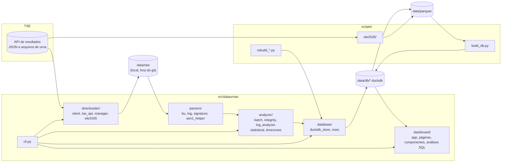
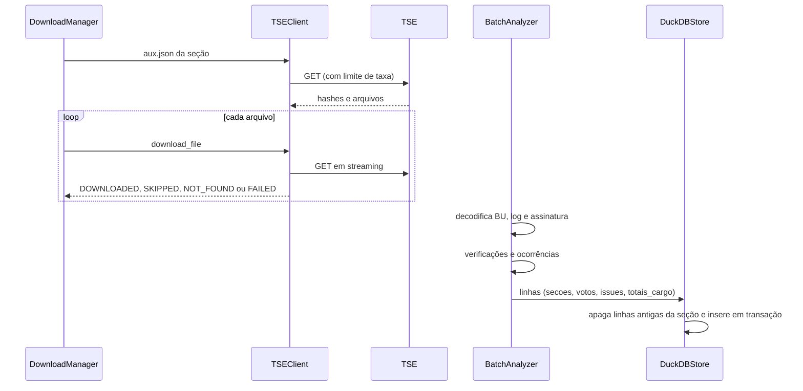
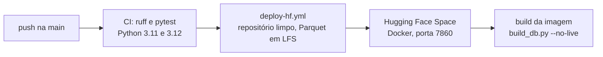

# Arquitetura

Visão dos módulos, do fluxo de dados e das decisões que sustentam o DataUrnas-BR.

## Visão geral

## Módulos

| Módulo | Responsabilidade |
|---|---|
| `config.py` | URLs da API, diretórios, UFs, eleições conhecidas (2022, 2024, 2026) e limites de rede |
| `models.py` | Modelos de domínio: seção, metadados de urna, BU, entradas de log, ocorrências e severidades |
| `downloader/client.py` | Cliente HTTP assíncrono: limite de taxa, retry com backoff e jitter, `Retry-After`, escrita atômica |
| `downloader/tse_api.py` | Navegação da API hierárquica (configuração, UF, seção, arquivos) |
| `downloader/manager.py` | Orquestração de downloads por UF ou amostra, com concorrência limitada e estatísticas |
| `downloader/ele2026.py` | URLs, parsing dos JSON e conversão de BU em linhas para 2026 |
| `parsers/bu.py` | Decodificação do BU (v1 e v2) para o modelo de domínio |
| `parsers/log.py` | Extração do log 7z em memória e identificação de eventos |
| `parsers/signature.py` | Leitura dos hashes assinados, verificação SHA-512 e modelo da urna |
| `analyzer/batch.py` | Análise completa de uma seção e de lotes de seções |
| `analyzer/integrity.py` | Hashes e consistência do BU |
| `analyzer/log_analyzer.py` | Horários, reinícios, erros, divergência log x BU |
| `analyzer/statistical.py` | Nulos, brancos, abstenção, biometria, outliers |
| `analyzer/timezones.py` | Fuso de cada UF |
| `database/rows.py` | Conversão do resultado de uma seção em linhas das quatro tabelas |
| `database/duckdb_store.py` | Esquema, inserção em lote com transação, consultas |
| `dashboard/` | Painel Streamlit com várias páginas, componentes reutilizáveis, filtros e consultas SQL |

## Fluxo de uma seção

## Banco de dados

| Tabela | Grão | Principais colunas |
|---|---|---|
| `secoes` | Seção e turno | `id`, `turno`, `uf`, `regiao`, `municipio`, `zona`, `secao`, `modelo_urna`, `tipo_urna`, `eleitores_aptos`, `comparecimento`, biometria, horários, `reboots`, `n_issues` |
| `votos` | Seção, cargo e candidato | `secao_id`, `cargo`, `tipo_voto`, `codigo_candidato`, `partido`, `quantidade` |
| `issues` | Ocorrência | `secao_id`, `codigo`, `severidade`, `descricao`, `base_legal`, `detalhes` |
| `totais_cargo` | Seção e cargo | `comparecimento`, `nominais`, `brancos`, `nulos`, `legenda`, `total` |

O DDL está em `data/parquet/schema.sql`. Os dados de 2026 ficam em arquivos próprios, descritos em [dados-2026.md](dados-2026.md).

## Decisões

- **Parquet como formato de distribuição.** Os 181 GB de arquivos brutos de 2022 não cabem em um repositório; os Parquet com ZSTD somam cerca de 183 MB e reconstroem o DuckDB em segundos.
- **DuckDB como motor analítico.** Consultas colunares sobre dezenas de milhões de linhas sem servidor.
- **Escrita atômica nos downloads.** Um processo interrompido nunca deixa arquivo parcial com o nome final, que seria aceito como completo na retomada.
- **Padrões de rede conservadores.** 50 downloads simultâneos e 200 requisições por segundo por padrão, ajustáveis por `DATAURNAS_MAX_CONCURRENT` e `DATAURNAS_RATE_LIMIT`. O servidor é público e compartilhado.
- **Falha de verificação separada de achado.** Códigos E distinguem "não foi possível verificar" de "verificado e divergente".
- **Coleta de 2026 sem dados brutos em disco.** O BU é baixado e decodificado em memória; só as linhas derivadas são gravadas, com checkpoint para retomada.

## Deploy

A imagem Docker roda com usuário sem privilégios, copia apenas a lista explícita de arquivos necessários e tem `HEALTHCHECK` no endpoint de saúde do Streamlit.
