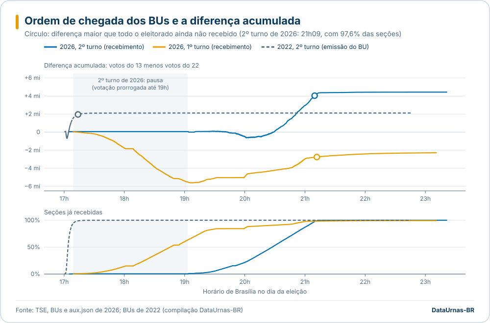
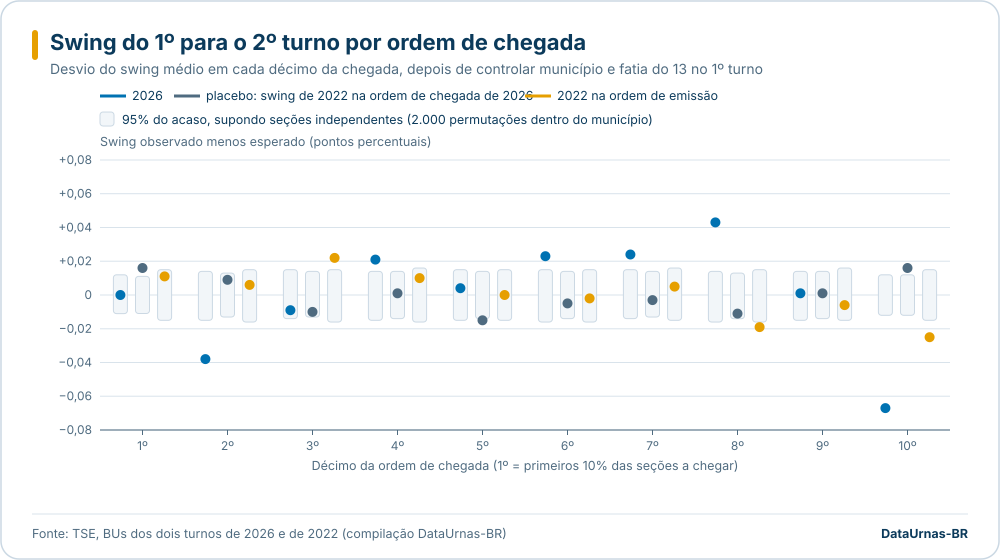
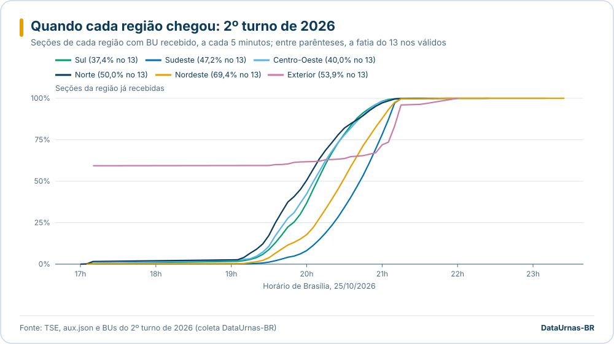
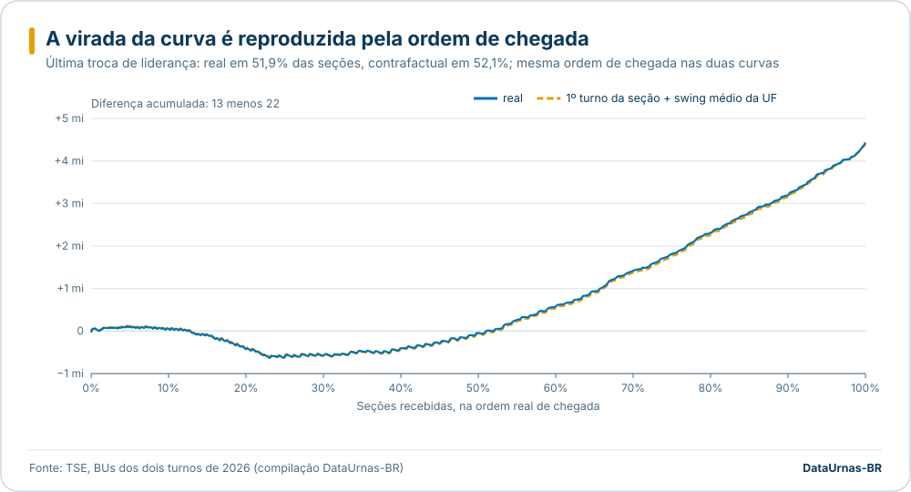
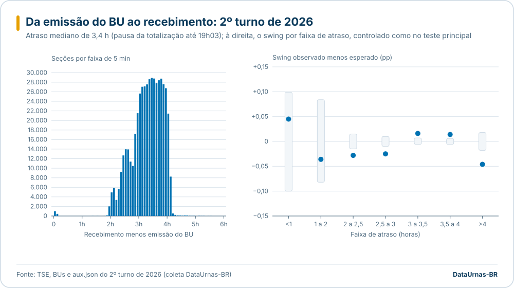

# Ordem e horário de chegada dos BUs à totalização: 2026 (1º e 2º turno) com 2022 como controle

Pergunta: a ordem e o horário em que os boletins de urna (BUs) chegaram à totalização mostram algum padrão que indique injeção de votos ou manipulação, em especial na virada da diferença acumulada a favor do 13 no 2º turno de 2026?

Este estudo complementa [ordem de envio e viradas](ordem-de-envio-viradas-2022-2026.md) (que trata dos cruzamentos da curva e das permutações da ordem), [viradas por seção](viradas-1t-2t-2026.md), [forense estatística](forense-estatistica-2026.md) e a seção 5 de [verificações externas](verificacoes-externas-2turno-2026.md) (linha do tempo de publicação e totalização). Aqui o foco é outro: se o **comportamento do voto** de cada seção depende do **momento em que ela chegou**.

## Resumo

| Teste | O que mostrou |
|---|---|
| 1. Curva da diferença acumulada | No 2º turno de 2026 a diferença (13 menos 22) trocou de sinal 26 vezes; a última às 20h28min48s, com 51,9% das seções. O resultado ficou matematicamente definido às 21h09min37s, com 97,6% das seções: dali em diante, a vantagem de 4.037.860 votos era maior que todo o eleitorado das seções ainda não recebidas (4.037.511). |
| 2. Swing por ordem de chegada | O swing (fatia do 13 no 2º turno menos a do 1º) não tem tendência ao longo da noite: inclinação de -0,002 ponto em todo o período, p = 0,66. Por décimo de chegada há desvios pequenos, de 0,04 a 0,07 ponto, com sinais alternados: o maior pesa 17 mil votos na margem de 4,43 milhões. Um placebo e 2022 mostram desvios do mesmo tipo, um pouco menores. Nada se concentra no momento da virada. |
| 3. Regiões e curva contrafactual | Norte, Sul e Centro-Oeste chegaram primeiro; o Nordeste (69,4% no 13) chegou depois e o Sudeste por último. Se cada seção repetisse o voto do 1º turno mais o swing médio do seu estado, a curva seria praticamente a mesma: virada em 52,1% das seções (real, 51,9%), afastamento máximo de 51 mil votos entre as duas curvas. |
| 4. Emissão do BU x recebimento | Atraso mediano de 3,4 horas, efeito da pausa da totalização durante a prorrogação até 19h. Como quase todos os BUs foram emitidos por volta das 17h, o atraso repete a ordem de chegada, e o swing por faixa de atraso mostra os mesmos desvios pequenos do teste 2 (no máximo 13 mil votos na margem). |
| 5. Últimas seções a chegar | O último 1% (4.992 seções, de 21h11 a 23h21) concentra SP (2.450) e BA (1.152), mais capitais (39% contra 21%) e nenhuma urna de contingência. Deu 59,0% ao 13 e responde por 5,3% da margem. O swing dessas seções ficou 0,1 ponto **abaixo** do esperado no modelo por município, ou seja, menos favorável ao 13, e sem diferença no modelo por zona. |

**Conclusão:** nada na ordem ou no horário de chegada indica injeção de votos. A virada da curva é explicada pela geografia da chegada e é reproduzida sem nenhum voto diferente do esperado (teste 3). O swing das seções que chegaram na hora da virada e no fim da noite não difere de forma relevante do esperado para o lugar e o voto do 1º turno. Há, sim, uma variação pequena do swing entre faixas de horário, maior em 2026 do que no placebo. Ela é da ordem de centésimos de ponto, troca de sinal e não chega a 1,5% da margem, mesmo somando todas as faixas em valor absoluto. Como esse teste não detecta adulteração do BU assinado, o que ele exclui é um padrão temporal de votos anômalos; a integridade do conteúdo dos BUs é tratada em [certificados e assinaturas](certificados-2turno-2026.md).

## Dados

| Eleição | Seções | Horário usado como "chegada" | Fonte |
|---|---:|---|---|
| 2026, 2º turno | 499.205 | recebimento publicado no aux.json (`v_bu_ultima.recebimento`, Brasília) | banco ClickHouse (`v_bu_ultima`, `v_votos_t2_secao`) |
| 2026, 1º turno | 499.206 com votos | recebimento do aux.json do 1º turno (`dt_recebimento`, `hr_recebimento`) | `ref_secoes_2026_t1`, `v_votos_t1_secao` |
| 2022, 2º turno | 470.834 | **emissão do BU** convertida para Brasília (a base não tem o recebimento de 2022) | `ref_secoes_2022`, `ref_votos_2022` |
| 2022, 1º turno | 470.819 | idem | idem |

- Swing de uma seção = fatia do 13 nos votos do 13 e do 22 no 2º turno menos a mesma fatia no 1º turno. Seções pareadas pelos códigos de UF, município, zona e seção, com votos no 13 ou no 22 nos dois turnos: 499.205 em 2026 (incluindo o exterior) e 470.808 em 2022 (sem exterior na base).
- Em 2022, a ordem pela emissão do BU é uma aproximação do fechamento da seção, não da chegada ao TSE. Serve de controle para o teste do swing, não para a curva de chegada propriamente dita.
- Votos de Presidente apenas.

## 1. Curva da diferença acumulada



"Definido" é o primeiro momento a partir do qual, até o fim, a diferença acumulada (em valor absoluto) supera a soma dos eleitores aptos das seções ainda não recebidas. Mesmo que todos esses eleitores votassem no candidato de trás, o resultado não mudaria.

| | 2026, 2º turno | 2026, 1º turno | 2022, 2º turno (emissão) | 2022, 1º turno (emissão) |
|---|---:|---:|---:|---:|
| Margem final (13 menos 22) | +4.430.191 | -2.224.965 | +2.118.359 | +6.156.174 |
| Trocas de liderança na ordem de chegada | 26 | 3 | 14 | 14 |
| Última troca: horário | 20:28:48 | 17:13:31 | 17:04:23 | 17:25:40 |
| Última troca: seções já recebidas | 51,9% | 0,5% | 60,7% | 75,8% |
| Resultado definido: horário | 21:09:37 | 21:11:50 | 17:13:48 | 19:01:44 |
| Resultado definido: seções já recebidas | 97,6% | 98,3% | 98,8% | 97,4% |
| Margem nesse momento | 4.037.860 | -2.754.517 | 1.954.319 | 4.773.408 |
| Aptos ainda não recebidos nesse momento | 4.037.511 | 2.754.245 | 1.954.102 | 4.773.046 |

- No 2º turno de 2026 a votação foi prorrogada até 19h e a totalização ficou parada de cerca de 17h06 a 19h03 ([prorrogação](prorrogacao-votacao-2turno-2026.md)). Até 17h09 só cerca de 2.160 seções (0,4%, contando o exterior) tinham recebimento publicado; o resto chegou de 19h03 em diante, quase tudo até 21h15 (a faixa cinza na figura marca a pausa). Por isso a curva do 2º turno começa tarde e sobe rápido.
- A margem que surge depois da última troca não é "nova": na seção 259.204 (51,9%) a diferença passa por zero porque as regiões que chegaram antes (Sul, Centro-Oeste, Norte) votaram mais no 22, e o Nordeste e parte do Sudeste chegaram depois (ver item 3).
- O resultado só ficou matematicamente definido com 97,6% das seções, porque até lá o eleitorado restante ainda era maior que a vantagem. Em 2022 a régua é a mesma, mas a ordem é a da emissão.

## 2. Swing por ordem de chegada (teste principal)



### Método

1. Ordem: as seções pareadas são ordenadas pelo horário de chegada e divididas em 10 faixas com o mesmo número de seções (décimos).
2. Esperado sem horário: regressão ponderada pelos votos válidos do 2º turno (13 e 22), com efeito fixo de município e efeito fixo de faixa da fatia do 13 no 1º turno (50 faixas de 2 pontos). O modelo não sabe o horário; o resíduo de cada seção é o swing que o lugar e o voto anterior não explicam.
3. Desvio da faixa: média ponderada do resíduo nas seções da faixa ("observado menos esperado"). Efeito na margem = 2 x desvio x votos válidos da faixa (um ponto a mais de fatia do 13 tira um ponto do 22).
4. Acaso: 2.000 permutações que embaralham a faixa de chegada **só entre seções do mesmo município** (a geografia fica fixa; só se quebra o vínculo com o horário). Daí o intervalo de 95% e o valor p de cada faixa, e o da tendência (inclinação do resíduo contra a posição na fila).
5. Variantes: efeito fixo de UF (permutação dentro da UF) e de zona eleitoral (permutação dentro da zona).
6. Placebo: o swing de **2022** das mesmas 460.094 seções (mesmos códigos de UF, município, zona e seção), ordenado pela chegada de **2026**. Nada em 2026 pode ter mudado esses votos; o que o placebo acusa é o quanto a geografia e o agrupamento das seções produzem sozinhos.

### Resultado de 2026 (499.205 seções, swing médio de +2,95 pontos)

| Décimo | Chegada | Swing observado | Esperado | Desvio (município) | IC 95% do acaso | p | Efeito na margem | Desvio (zona) | p (zona) |
|---|---|---:|---:|---:|---|---:|---:|---:|---:|
| 1º | até 19:38:15 | 2,768 | 2,769 | -0,000 | -0,011 a 0,012 | 0,94 | -125 | -0,010 | 0,08 |
| 2º | 19:38 a 19:57 | 2,845 | 2,883 | **-0,038** | -0,015 a 0,014 | 0,0005 | -9.380 | **-0,045** | 0,0005 |
| 3º | 19:57 a 20:08 | 2,904 | 2,913 | -0,009 | -0,014 a 0,015 | 0,20 | -2.289 | -0,008 | 0,24 |
| 4º | 20:08 a 20:18 | 2,949 | 2,928 | **+0,021** | -0,015 a 0,014 | 0,009 | +5.212 | **+0,019** | 0,010 |
| 5º | 20:18 a 20:27 | 2,931 | 2,927 | +0,004 | -0,015 a 0,015 | 0,57 | +1.024 | -0,007 | 0,32 |
| 6º (virada às 20:28:48) | 20:27 a 20:35 | 2,956 | 2,932 | **+0,023** | -0,016 a 0,015 | 0,003 | +5.778 | +0,008 | 0,23 |
| 7º | 20:35 a 20:44 | 2,954 | 2,930 | **+0,024** | -0,014 a 0,015 | 0,001 | +6.042 | **+0,015** | 0,036 |
| 8º | 20:44 a 20:53 | 3,043 | 3,000 | **+0,043** | -0,016 a 0,014 | 0,0005 | +10.636 | **+0,023** | 0,001 |
| 9º | 20:53 a 21:02 | 3,105 | 3,104 | +0,001 | -0,015 a 0,014 | 0,85 | +344 | 0,000 | 0,99 |
| 10º | 21:02 a 23:21 | 3,070 | 3,137 | **-0,067** | -0,012 a 0,012 | 0,0005 | -17.242 | +0,004 | 0,48 |

Valores em pontos percentuais. O 1º décimo inclui o exterior, que chega desde a madrugada (fusos da Ásia e Oceania). Em negrito, p abaixo de 0,05.

### Calibração: 2026, placebo e 2022

| Série | Seções | Tendência em todo o período (pontos) | p da tendência | Décimos com p < 0,05 | Soma dos efeitos na margem, em valor absoluto |
|---|---:|---:|---:|---:|---:|
| 2026, município | 499.205 | -0,002 | 0,66 | 6 de 10 | 58.072 |
| 2026, zona | 499.205 | +0,038 | 0,0005 | 4 de 10 | 34.230 |
| 2026, mesmas seções do placebo, município | 460.094 | -0,005 | 0,38 | 6 de 10 | 55.051 |
| 2026, mesmas seções do placebo, zona | 460.094 | +0,035 | 0,0005 | 5 de 10 | 32.763 |
| **Placebo** (swing de 2022 na ordem de 2026), município | 460.094 | -0,004 | 0,45 | 3 de 10 | 20.401 |
| **Placebo**, zona | 460.094 | -0,018 | 0,0005 | 1 de 10 | 20.598 |
| 2022 na ordem de emissão, município | 470.808 | -0,038 | 0,0005 | 3 de 10 | 25.169 |
| 2022 na ordem de emissão, zona | 470.808 | -0,008 | 0,31 | 0 de 10 (o 3º com p = 0,05) | 13.697 |

Como ler:

- O placebo não pode ter sido afetado por 2026 e mesmo assim tem décimos e tendência "significativos". Isso mostra que a permutação por seção subestima o acaso. Seções do mesmo local de votação chegam juntas e votam parecido, e o teste as trata como independentes. Os valores p acima devem ser lidos como otimistas.
- Mesmo com essa ressalva, 2026 tem cerca de 2,7 vezes mais variação ligada ao horário que o placebo nas mesmas seções: 55 mil contra 20 mil votos somados. Em grandeza, são décimos com desvio de 0,02 a 0,07 ponto de fatia.
- Os sinais se alternam: o 2º e o 10º décimos ficaram **abaixo** do esperado (menos swing para o 13), e do 4º ao 8º acima. A soma dos desvios é zero por construção, e o padrão não é o de votos acrescentados de um lado ao longo da noite. A tendência por município é nula (p = 0,66). No modelo por zona, o swing das últimas seções é 0,038 ponto maior que o das primeiras. Isso equivale a cerca de 12 mil votos a mais na margem do 13 na segunda metade da fila e 12 mil a menos na primeira. O placebo tem tendência de metade disso, no sentido oposto.
- O 10º décimo muda de sinal entre os modelos (-0,067 por município, +0,004 por zona). O desvio vem de quais zonas de cada município chegaram por último, não das seções em si.
- Na faixa da virada (6º décimo, 20:27 a 20:35) o desvio é de +0,023 ponto por município e +0,008 (p = 0,23) por zona: no máximo 5.778 votos na margem, sem relação com a troca de liderança, que acontece também na curva contrafactual (item 3).
- Uma hipótese compatível, não testada aqui: a prorrogação até 19h em parte do país mudou o perfil de quem votou no fim do dia em algumas zonas, e a fila de transmissão depois da pausa misturou a ordem de chegada com esse perfil. Ver [prorrogação](prorrogacao-votacao-2turno-2026.md) e [encerramento tardio](encerramento-tardio-2turno-2026.md).

### 2022 na própria ordem (emissão do BU, controle)

| Décimo | 1º | 2º | 3º | 4º | 5º | 6º | 7º | 8º | 9º | 10º |
|---|---:|---:|---:|---:|---:|---:|---:|---:|---:|---:|
| Desvio (município) | +0,011 | +0,006 | **+0,022** | +0,010 | 0,000 | -0,002 | +0,005 | **-0,019** | -0,006 | **-0,025** |
| p | 0,15 | 0,41 | 0,004 | 0,24 | 0,97 | 0,85 | 0,50 | 0,018 | 0,45 | 0,002 |
| Efeito na margem | +2.601 | +1.425 | +5.032 | +2.228 | +54 | -372 | +1.244 | -4.550 | -1.458 | -6.205 |

Swing médio em 2022: -1,63 ponto (o 13 perdeu fatia do 1º para o 2º turno). Os desvios por décimo são da mesma ordem dos de 2026.

## 3. Chegada por região e curva contrafactual



| Região (2º turno de 2026) | Seções | Fatia do 13 nos válidos | Margem (13 menos 22) | Chegada: 10% | Mediana | 90% | Posição média na fila |
|---|---:|---:|---:|---|---|---|---:|
| Norte | 43.769 | 50,0% | +1.079 | 19:21 | 19:59 | 20:45 | 28,9% |
| Centro-Oeste | 38.048 | 40,0% | -1.869.948 | 19:28 | 20:05 | 20:45 | 32,5% |
| Sul | 72.015 | 37,4% | -4.576.523 | 19:31 | 20:08 | 20:42 | 33,7% |
| Exterior | 1.308 | 53,9% | +28.657 | 06:32 | 15:31 | 21:11 | 34,7% |
| Nordeste | 140.828 | 69,4% | +13.653.696 | 19:41 | 20:28 | 21:02 | 51,1% |
| Sudeste | 203.237 | 47,2% | -2.806.770 | 20:03 | 20:42 | 21:06 | 62,9% |

No 1º turno de 2026 a ordem foi parecida, mas mais espalhada: Sul e Centro-Oeste com posição média de 35% e 33%, Norte 44%, Sudeste 55%, Nordeste 58%.

A virada vem daí: na primeira metade da fila há proporcionalmente mais seções do Sul e do Centro-Oeste (onde o 22 venceu por 4,6 e 1,9 milhões), e na segunda metade mais do Nordeste (onde o 13 abriu 13,7 milhões) e do Sudeste.



Contrafactual: cada seção recebe a fatia do 13 que teve no 1º turno somada ao swing médio do seu estado (de +1,36 ponto no PI a +4,13 no RJ; exterior +1,55), aplicada aos votos válidos reais do 2º turno, **na mesma ordem de chegada**. A curva contrafactual não usa nenhuma informação do horário nem do voto da seção no 2º turno além do total de válidos.

| | 2026 | 2022 |
|---|---:|---:|
| Margem final real | 4.430.191 | 2.118.359 |
| Margem final contrafactual | 4.427.824 | 2.118.364 |
| Última troca de liderança, real | 51,92% das seções (20:28:48) | 60,74% |
| Última troca de liderança, contrafactual | 52,09% das seções (20:29:04) | 62,90% |
| Maior afastamento entre as curvas | 51.230 votos, em 84% das seções | 69.469 votos, em 69% das seções |

A virada acontece 16 segundos (822 seções) depois na curva contrafactual. O afastamento máximo entre as duas curvas, 51 mil votos, é menor que o de 2022 (69 mil) e equivale a 1,2% da margem final.

## 4. Emissão do BU e recebimento



Atraso = recebimento publicado (Brasília) menos emissão do BU (relógio da urna convertido para Brasília pelo fuso do município; exterior fora).

| Quantil do atraso (min) | 1% | 10% | 25% | 50% | 75% | 90% | 99% | 99,9% | Máximo |
|---|---:|---:|---:|---:|---:|---:|---:|---:|---:|
| 2026, 2º turno (497.897 seções) | 121,0 | 151,6 | 178,0 | 201,4 | 223,2 | 236,5 | 246,7 | 267,8 | 374,3 |
| 2026, 1º turno (497.897 seções) | 14,9 | 40,1 | 65,2 | 89,0 | 118,5 | 160,3 | 252,5 | 4.034,2 | 4.195,5 |

- No 2º turno, quase todos os BUs foram emitidos por volta das 17h e só foram recebidos depois da pausa (19h03 em diante). Daí o atraso mediano de 3,4 h, contra 1,5 h no 1º turno. As 1.464 seções com atraso de até 1 h devem ser, em boa parte, as que encerraram depois das 19h e transmitiram logo (não conferido seção a seção). Há 17 seções com recebimento antes da emissão (2º turno), já descritas na seção 5.1 de [verificações externas](verificacoes-externas-2turno-2026.md).
- No 1º turno a cauda longa (99,9% em 67 h) é de seções do PR recebidas em 07/10 (ver item 5).

Swing por faixa de atraso (2º turno de 2026, mesmo modelo e mesma permutação do teste 2):

| Faixa de atraso | Seções | Desvio (município) | IC 95% do acaso | p | Efeito na margem | Desvio (zona) | p (zona) |
|---|---:|---:|---|---:|---:|---:|---:|
| até 1 h | 1.464 | +0,045 | -0,100 a 0,099 | 0,38 | +309 | +0,043 | 0,41 |
| 1 a 2 h | 2.171 | -0,036 | -0,082 a 0,084 | 0,38 | -413 | +0,015 | 0,69 |
| 2 a 2,5 h | 41.731 | **-0,028** | -0,015 a 0,015 | 0,0005 | -5.999 | **-0,023** | 0,001 |
| 2,5 a 3 h | 88.466 | **-0,025** | -0,010 a 0,010 | 0,0005 | -10.737 | **-0,031** | 0,0005 |
| 3 a 3,5 h | 164.887 | **+0,016** | -0,006 a 0,007 | 0,0005 | +12.675 | **+0,008** | 0,010 |
| 3,5 a 4 h | 168.066 | **+0,014** | -0,006 a 0,006 | 0,001 | +11.306 | **+0,009** | 0,001 |
| mais de 4 h | 31.112 | **-0,046** | -0,018 a 0,018 | 0,0005 | -7.141 | **+0,027** | 0,001 |

Como a emissão é quase a mesma para todos, o atraso é praticamente o horário de chegada, e esta tabela repete o padrão do teste 2: desvios de centésimos de ponto, com sinais alternados, que mudam de sinal entre modelos na faixa mais longa, sujeitos à mesma ressalva de calibração. Seções com atraso grande não tiveram swing sistematicamente maior para o 13.

## 5. As últimas seções a chegar

| | 2026, 2º turno: último 1% | 2026, 2º turno: último 0,1% | 2022, 2º turno: último 1% (emissão) | 2026, 1º turno: último 1% |
|---|---:|---:|---:|---:|
| Seções | 4.992 | 499 | 4.708 | 4.992 |
| Chegada | 21:11:24 a 23:21:40 | 21:39:38 a 23:21:40 | 17:14 a 22:45 | 04/10 21:49 a 07/10 15:00 |
| Principais UFs | SP 2.450, BA 1.152, MG 185, PE 177, CE 171, PB 153, exterior 136 | MG 159, BA 128, SP 48, PE 47, exterior 41, MA 36 | RJ 928, SP 823, BA 580, MA 387 | PA 1.876, BA 804, MA 558, PR 502 |
| Exterior | 2,7% | 8,2% | (fora da base) | 1,1% |
| Em capital (geral: 20,6% em 2026, 21,0% em 2022) | 39,1% | 18,6% | 34,3% | 37,7% |
| Urna de reserva (geral: 1,14% em 2026; 3,80% em 2022) | 67 (1,3%) | 7 (1,4%) | 437 (9,3%) | 46 (0,9%) |
| Urna de contingência (29 seções em todo o 2º turno de 2026) | 0 | 0 | 0 | 4 |
| Atraso mediano (emissão ao recebimento) | 248 min | 282 min | | 1.241 min |
| Fatia do 13 nos válidos | 59,0% | 68,2% | 55,8% | 60,5% |
| Margem dessas seções (13 menos 22) | +233.139 | +43.282 | +140.363 | +238.453 |
| Parte da margem final | 5,3% | 1,0% | 6,6% | 10,7% (contra o sinal da margem final) |

Swing dessas seções contra o esperado (mesmo modelo do teste 2):

| | Swing observado | Esperado | Desvio (município) | IC 95% | p | Efeito na margem | Desvio (zona) | p (zona) |
|---|---:|---:|---:|---|---:|---:|---:|---:|
| 2026, último 1% | 2,639 | 2,739 | -0,099 | -0,051 a 0,050 | 0,0005 | -2.561 | +0,023 | 0,26 |
| 2026, último 0,1% | 1,589 | 1,791 | -0,202 | -0,136 a 0,132 | 0,004 | -483 | -0,058 | 0,35 |
| 2022, último 1% | -1,547 | -1,527 | -0,020 | -0,053 a 0,053 | 0,46 | -488 | +0,004 | 0,88 |
| 2022, último 0,1% | -1,697 | -1,713 | +0,016 | -0,168 a 0,166 | 0,85 | +35 | +0,034 | 0,68 |

- As últimas seções do 2º turno de 2026 dão muito ao 13 porque são de lugares que já davam muito ao 13 no 1º turno (capital de SP, BA, Nordeste), não porque mudaram mais. O swing delas ficou **abaixo** do esperado no modelo por município (menos favorável ao 13, 2.561 votos na margem) e igual ao esperado no modelo por zona.
- No 2º turno de 2026 não há urna de contingência entre as últimas, e a proporção de urnas de reserva é a mesma do total. Em 2022 (ordem de emissão), as últimas tinham muito mais urnas de reserva (9,3% contra 3,8%), o que é esperado: a urna substituída emite o BU mais tarde.
- O 1º turno de 2026 tem um caso à parte: 481 das últimas 499 seções são do PR, com recebimento publicado entre 12h19 e 15h00 de 07/10, três dias depois da eleição (em capital, 70,9%). Elas deram 33,3% ao 13 e não mudam a conclusão daquele turno, mas o motivo do horário não foi investigado aqui.
- Zona rural: a base do projeto não tem a classificação urbana ou rural do local de votação. A proporção de seções em capitais foi usada como aproximação do perfil urbano.

## O que este estudo não cobre

- **Conteúdo dos BUs.** Se um BU fosse adulterado antes de ser assinado, a ordem de chegada não mostraria isso. A soma dos 499.207 BUs assinados bate com o total oficial, e a verificação das assinaturas está em [certificados](certificados-2turno-2026.md).
- **Recebimento real.** O horário do aux.json é o registro do pacote no sistema de divulgação. Em parte das seções ele é posterior à totalização que já as incluía (seção 5.3 de [verificações externas](verificacoes-externas-2turno-2026.md)), de modo que a ordem usada aqui é a da publicação, não necessariamente a da chegada física ao TSE.
- **2022 sem recebimento.** Em 2022 só há a hora de emissão do BU. A curva de 2022 está na escala da emissão (fechamento das seções), e o controle do teste 2 compara ordens de natureza diferente. Por isso o placebo (2022 na ordem de 2026) é o controle principal.
- **Independência entre seções.** As permutações supõem que, no mesmo município (ou zona), qualquer seção poderia ter chegado em qualquer posição. Seções do mesmo local de votação chegam juntas e votam parecido, e o placebo mostra que isso torna os valores p otimistas. Uma permutação por local de votação seria mais adequada; o código do local está no BU de 2026, mas não na base de 2022.
- **Seções sem par.** 41 seções do 2º turno de 2026 sem BU ("Não instalada") ficam fora; no cálculo do momento definido, o eleitorado delas não entra no restante (é desprezível perto das margens).
- **Fuso de 2022.** O fuso de 2022 vem da base de 2022 (AM inteiro em UTC-4, sem os municípios do oeste em UTC-5). Afeta poucas seções e só a ordem de 2022.

## Como reproduzir

Exportação e análise rodam no servidor de processamento (o banco ClickHouse fica lá); as figuras são geradas localmente a partir das saídas pequenas.

```sh
# copiar o código para o servidor
scp scripts/ele2026/chegada_bus.py scripts/ele2026/chegada_bus.sql \
  scripts/ele2026/analisar_encerramento_t2.py servidor:/dev/shm/chegada/

# no servidor: exportar (4 Parquet, cerca de 20 MB), analisar e rodar o placebo
cd <clone do repositório no servidor>
uv run python /dev/shm/chegada/chegada_bus.py export  --sql /dev/shm/chegada/chegada_bus.sql --out /dev/shm/chegada/data
uv run python /dev/shm/chegada/chegada_bus.py analyze --data /dev/shm/chegada/data --out /dev/shm/chegada/out
uv run python /dev/shm/chegada/chegada_bus.py placebo --data /dev/shm/chegada/data --out /dev/shm/chegada/out

# trazer as saídas e gerar as figuras
scp 'servidor:/dev/shm/chegada/out/*' data/parquet/2026/t2/chegada/
uv run python scripts/ele2026/chegada_bus.py figures --res data/parquet/2026/t2/chegada
```

A análise leva poucos minutos com 50 processos (2.000 permutações por teste). As permutações usam sementes fixas, e os resultados se repetem exatamente.

Saídas em `data/parquet/2026/t2/chegada/`:

| Arquivo | Conteúdo |
|---|---|
| `resultado.json` | todos os números deste relatório (curvas, decis por modelo, placebo, regiões, contrafactual, atraso, últimas seções) |
| `curvas.parquet` | pontos da diferença acumulada e das seções recebidas, por eleição |
| `regioes.parquet` | chegada acumulada por região a cada 5 minutos |
| `contrafactual.parquet` | curvas real e contrafactual de 2026 e 2022 |

Figuras: `docs/assets/2026-chegada-curva.svg`, `2026-chegada-swing-decis.svg`, `2026-chegada-regioes.svg`, `2026-chegada-contrafactual.svg` e `2026-chegada-atraso.svg`.
