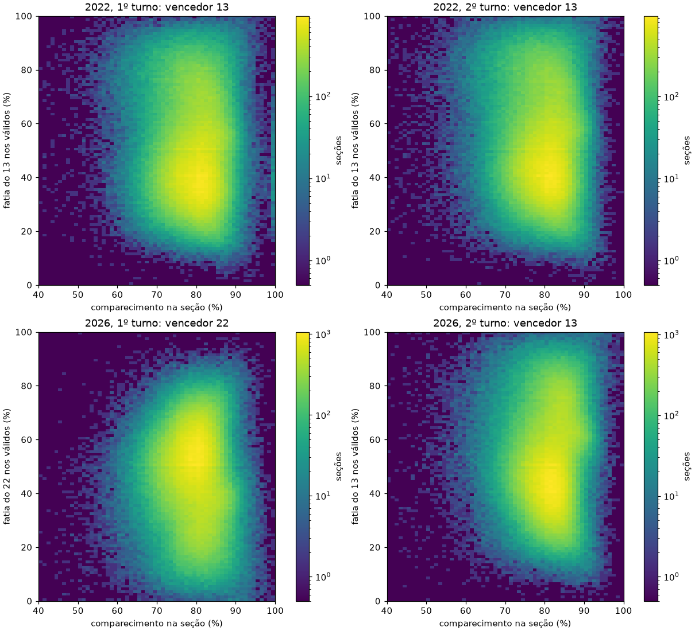
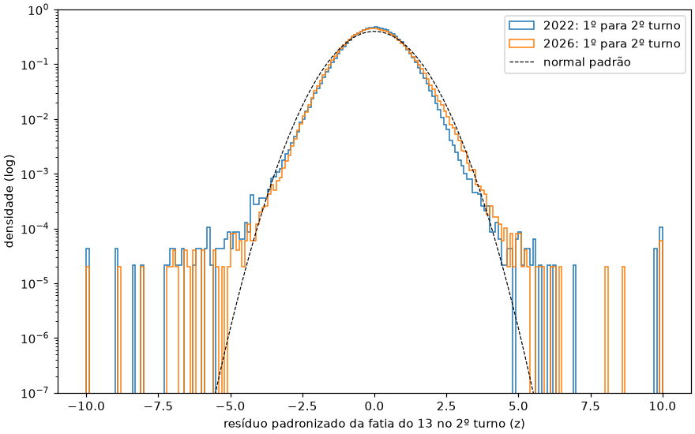

# Forense estatística por seção: 2026 (1º e 2º turno) com 2022 como controle

Levantamento de 27/10/2026. A pergunta é se os resultados por seção da eleição presidencial de 2026 (1º turno em 04/10, 2º turno em 25/10; 13 = Lula, 22 = Flávio Bolsonaro) trazem algum dos padrões que a literatura de forense eleitoral associa a fraude ou manipulação: enchimento de urna, números fabricados, deslocamento de votos concentrado em lugares específicos, uniformidade artificial ou comparecimento inflado a favor de um candidato.

Cada teste foi aplicado com a mesma régua, seção a seção, aos dois turnos de 2022 (13 = Lula, 22 = Jair Bolsonaro). 2022 serve de controle: o que aparece nos dois anos com o mesmo tamanho é propriedade normal do eleitorado brasileiro e do método, não sinal de 2026. Nenhum resultado aqui afirma fraude ou a descarta sem base; o documento separa o que é anomalia que merece conferência do que é ruído esperado para uma amostra de meio milhão de seções.

Este levantamento não refaz o que já está em `docs/viradas-1t-2t-2026.md` (viradas por seção, decomposição do ganho e troca mínima), `docs/ordem-de-envio-viradas-2022-2026.md` (ordem de chegada) e `docs/encerramento-tardio-2turno-2026.md`; ele complementa esses relatórios com outras seis frentes.

Arquivos:

| Arquivo | Para quê |
|---|---|
| `scripts/ele2026/forense_estatistica.py` | exportação do ClickHouse (`exportar`) e as seis análises (`analisar`) |
| `docs/img/forense-impressao-digital-2022-2026.png` | histograma 2D comparecimento x fatia do vencedor, quatro eleições |
| `docs/img/forense-swing-residuos-2022-2026.png` | distribuição dos resíduos padronizados do swing, 2022 e 2026 |

Saída, fora do git: `data/parquet/2026/t2/forense/` (`resumo.json` com todas as métricas; `impressao_digital_uf.csv`, `impressao_digital_canto_95_95.csv`; `digitos.csv` e `.parquet`; `swing_secoes_z4.csv`, `swing_aglomerados.parquet`, `swing_aglomerados_atipicos.csv`, `swing_persistentes.csv`; `comparecimento_concentrado.csv`; `dispersao_grupos.parquet`, `dispersao_subdispersos.csv`; as duas figuras).

Como foi rodado (27/10/2026, no servidor de processamento, tudo em `/dev/shm`):

```sh
# exporta 2022 (1º e 2º turno), 2026 1º turno (referências) e 2026 2º turno (v_bu_ultima + bu_votos)
uv run --no-project --with pandas,numpy,scipy,pyarrow,matplotlib \
    python scripts/ele2026/forense_estatistica.py exportar --dir /dev/shm/forense/dados
# seis análises, 960 simulações por teste de dígitos (cerca de 4 min com 48 processos)
uv run --no-project --with pandas,numpy,scipy,pyarrow,matplotlib \
    python scripts/ele2026/forense_estatistica.py analisar \
    --dados /dev/shm/forense/dados --saida /dev/shm/forense/saida --sims 960 --workers 48
```

## Dados

| Conjunto | Seções | Origem |
|---|---:|---|
| 2022, 1º turno | 470.819 | `ref_secoes_2022` + `ref_votos_2022` (turno 1) |
| 2022, 2º turno | 470.834 | idem (turno 2) |
| 2026, 1º turno | 497.897 | `ref_secoes_2026_t1` (status `ok`) + `ref_votos_2026_t1` |
| 2026, 2º turno | 497.897 | `v_bu_ultima` + `bu_votos` (última versão do BU) |

Exterior (`zz`) fora em todos. Para o pareamento entre turnos (frentes 3, 4 e 6) entram as seções presentes nos dois turnos com variação de aptos de no máximo 10% e pelo menos 20 votos em 13 + 22 no 2º turno: 469.574 em 2022 (1.234 descartadas) e 497.790 em 2026 (107 descartadas).

Candidatos do 1º turno tratados em separado: em 2026, 70, 14 e 55 (3,45 mi, 2,68 mi e 2,61 mi de votos); em 2022, 15, 12 e 44. Os demais somam "outros menores".

Limitação de dado: as referências de 2022 não têm o local de votação (`local_votacao`), que só existe no BU de 2026. Por isso as comparações no nível de local de votação usam o 1º turno de 2026 como controle do 2º turno; para 2022 o nível mais fino comparável é a zona.

Observação sobre o controle: 644 seções do 1º turno de 2022 têm comparecimento maior que o número de aptos na referência (nenhuma em 2022 2º turno e nenhuma em 2026). É uma particularidade da base de 2022 (não investigada aqui), não de 2026; essas seções inflam a contagem de comparecimento acima de 95% no 1º turno de 2022 e não foram usadas para concluir nada.

## Resumo dos achados

| # | Frente | 2026 | 2022 (controle) | Leitura | Gravidade |
|---|---|---|---|---|---|
| 1 | Impressão digital: seções com comparecimento ≥ 95% e fatia do vencedor ≥ 95% | 2º turno: 64 (1,29 por 10 mil) | 2º turno: 31 (0,66 por 10 mil) | dobra, mas acompanha o comparecimento mais alto de 2026; 60 das 64 já davam ≥ 90% ao 13 no 1º turno | nenhuma (explicado) |
| 1 | Inclinação da fatia do 13 sobre o comparecimento, dentro do município | 2º turno: -0,156 | 2º turno: -0,172 | mesmo sinal e tamanho; o sinal de enchimento seria inclinação positiva | nenhuma |
| 2 | Último dígito (13 e 22, contagens ≥ 10) | p simulado de 0,42 a 0,82 no 2º turno; 0 de 54 grupos UF com p < 0,001 | p de 0,07 a 0,47; 0 de 54 | uniforme como esperado | nenhuma |
| 2 | 2º dígito (2BL), desvio contra o nulo simulado | 2º turno: z = -1,2 (13) e -3,8 (22); 9 de 54 grupos UF com \|z\| > 3 | 2º turno: z = -1,0 e -6,6; 12 de 54 | desvios do mesmo tamanho, nas mesmas UFs (RJ, CE, SP) nos dois anos | nenhuma |
| 3 | Swing 1º para 2º turno: seções com \|z\| > 4 | 127 (2,55 por 10 mil) | 163 (3,47 por 10 mil) | cauda menor em 2026; curtose 0,6 contra 21,1 | nenhuma |
| 3 | Seções atípicas que já eram atípicas em 2022 | 17 das 103 com \|z\| > 4 tinham \|z\| > 3 em 2022 (0,19 esperado) | n/a | atipicidade concentrada em seções estruturalmente voláteis | informativo |
| 3 | Aglomerados de resíduo (zona, Stouffer \|S\| > 6) | 48 de 725 zonas | 27 de 721 | maior em 2026, quase só zonas de capitais (SP, RJ, DF), nos dois sentidos | baixa |
| 3 | Municípios inteiros fora do padrão (z robusto \|z\| > 5) | 6 | 7 | mesma frequência | nenhuma |
| 4 | 22 perde votos absolutos de forma incomum (≥ 10 votos e ≥ 20% além do que a queda de comparecimento explica) | 388 seções; o modelo de swing sozinho gera 434 ± 21 (0,89) | o perdedor do movimento (13) teve 82; esperado 103 ± 11 (0,80) | dentro do esperado para o tamanho do movimento | nenhuma |
| 4 | Ganho maior que todo o estoque sem troca (outros + brancos + nulos + abstenção do 1º turno) | 13: 10 seções; 22: 1 | 13: 7; 22: 6 | igual a 2022 | nenhuma |
| 4 | Transferência estimada de brancos do 1º turno para o 13 | 0,88 (Goodman) e 0,67 (com efeito de município) | 0,08 e 0,12 | diferença real de comportamento: brancos e nulos caíram 1,5 ponto em 2026 e subiram 0,2 em 2022 | informativo |
| 5 | Locais de votação "uniformes demais" (subdispersão, p < 0,01) | 2º turno: 398 de 72.378 (esperado 724 sob binomial); 1º turno: 399 | sem local em 2022 | abaixo do esperado e igual entre turnos | nenhuma |
| 5 | Resultados idênticos na mesma zona, contra zonas sorteadas da mesma UF | razão 3,09 | razão 3,09 (2º turno) | idêntica | nenhuma |
| 6 | Comparecimento acima do município com ganho concentrado | 13: 2 seções; 22: 5 | 13: 1; 22: 0 | raro nos dois anos; em 2026 favorece mais o 22 | baixa |
| 6 | Inclinação da variação de fatia do 13 sobre o excesso de comparecimento | +0,025 | +0,051 | acoplamento comparecimento-voto menor em 2026 | nenhuma |

Em poucas linhas: nenhuma das seis frentes mostra em 2026 um padrão agregado que não exista com tamanho igual ou maior em 2022. Os pontos que merecem conferência são locais e pequenos (seções listadas no fim), e aparecem nos dois sentidos políticos.

## 1. Impressão digital eleitoral (Klimek et al., 2012)

Para cada seção com pelo menos 20 aptos: comparecimento = comparecimento ÷ aptos; fatia do vencedor = votos do vencedor ÷ votos nominais válidos. Vencedor: 13 em 2022 (os dois turnos) e no 2º turno de 2026; 22 no 1º turno de 2026. O enchimento de urna aparece como uma "mancha" no canto de comparecimento e fatia próximos de 100% e como correlação positiva forte entre comparecimento e fatia do vencedor dentro de uma mesma área.



| Métrica | 2022 1º | 2022 2º | 2026 1º | 2026 2º |
|---|---:|---:|---:|---:|
| Comparecimento médio | 79,32% | 79,58% | 79,16% | 81,01% |
| Desvio padrão do comparecimento entre seções | 7,23 | 6,03 | 5,56 | 5,46 |
| Seções com comparecimento ≥ 95% | 1.243 | 232 | 559 | 639 |
| Seções com comparecimento = 100% | 32 | 4 | 15 | 12 |
| Fatia do 13 ≥ 95% | 1.275 | 2.470 | 849 | 1.746 |
| Canto: comparecimento ≥ 95% e 13 ≥ 95% | 24 | 31 | 26 | 64 |
| Canto: comparecimento ≥ 95% e 22 ≥ 95% | 0 | 2 | 1 | 2 |
| Inclinação da fatia do 13 sobre o comparecimento, efeito fixo de município | -0,114 | -0,172 | -0,178 | -0,156 |
| Correlação correspondente | -0,07 | -0,10 | -0,11 | -0,08 |

O que os números dizem:

1. **Não há nuvem secundária nem massa no canto superior direito.** As quatro figuras têm uma só nuvem, com cauda contínua para fatias altas no Norte e Nordeste e nenhum acúmulo em (100%, 100%).
2. **O canto 95/95 do 13 dobrou no 2º turno (31 para 64), mas acompanha o comparecimento.** Em 2026 há 2,75 vezes mais seções com comparecimento ≥ 95% no 2º turno (639 contra 232); a fração delas que também dá ≥ 95% ao 13 é menor em 2026 (10,0%) que em 2022 (13,4%). Das 64, 60 já davam ≥ 90% dos válidos ao 13 no 1º turno de 2026 e 28 já tinham comparecimento ≥ 95% no 1º turno; a variação mediana de comparecimento delas foi +1,75 ponto, igual à nacional (+1,85). São quase todas seções de aldeias e comunidades tradicionais (Benjamin Constant, São Paulo de Olivença e Itamarati no AM; Barra do Corda, Arame e Fernando Falcão no MA; Tocantinópolis e Goiatins no TO; Pesqueira em PE; Confresa e Gaúcha do Norte em MT; Uiramutã em RR; Porto Real do Colégio em AL; Rodelas na BA). A lista está em `impressao_digital_canto_95_95.csv`.
3. **A inclinação dentro do município é negativa para o 13 nos quatro casos, com o mesmo tamanho.** Onde o comparecimento é mais alto dentro do mesmo município, a fatia do 13 é menor (padrão socioeconômico conhecido). Um enchimento de urna a favor do 13 empurraria essa inclinação para cima no 2º turno de 2026; ela ficou entre os valores de 2022.
4. **Por UF, a variação da inclinação entre turnos tem a mesma dispersão nos dois anos.** A mudança da inclinação do 13 do 1º para o 2º turno teve média 0,00 e desvio 0,15 entre UFs em 2026, contra -0,04 e 0,14 em 2022. As maiores altas em 2026 foram BA (+0,18), MS (+0,17) e PI (+0,16); em 2022, RR (+0,29) e PI (+0,19). Em 2026 a inclinação do 2º turno é positiva em CE (+0,24), PI (+0,27), RR (+0,43), RO (+0,15) e AM (+0,12), mas essas UFs já tinham inclinação positiva do 13 no 1º turno de 2026 (CE +0,11, PI +0,11, RR +0,56, RO +0,19, AM +0,29), quando quem venceu foi o 22. A frente 6 mostra que, seção a seção, o aumento de comparecimento não veio acompanhado de ganho extra do 13.

## 2. Dígitos: último dígito e 2º dígito de Benford (2BL)

Para os votos de 13 e de 22 em cada seção:

- **Último dígito**, contagens ≥ 10 e ≥ 100. Números escritos à mão ou inventados tendem a fugir da distribuição uniforme do último dígito.
- **2º dígito de Benford (2BL, Mebane)**, contagens ≥ 10: a referência teórica tem média 4,187.

Com meio milhão de seções, qualquer desvio minúsculo dá p-valor zero contra a distribuição teórica. Por isso cada teste tem duas referências: a teórica (uniforme ou Benford) e uma **simulada**, que reproduz a eleição sem nenhuma manipulação. Na simulação, a fatia de cada seção é sorteada de uma Beta com a média do município (sem a própria seção) e a variância entre seções observada no município, e os votos de uma binomial com o total de válidos da seção. Foram 960 simulações por teste e por eleição, que dão o p empírico (fração das simulações com qui-quadrado maior que o observado) e o z da média do dígito.

Brasil, por eleição e candidato:

| Eleição | Cand. | Último dígito ≥ 10: qui² teórico | p simulado | Último ≥ 100: qui² teórico | p simulado | 2BL: média | média simulada | z | p simulado |
|---|---|---:|---:|---:|---:|---:|---:|---:|---:|
| 2022 1º | 13 | 15,5 | 0,070 | 535,6 | 0,059 | 3,849 | 3,832 | +4,4 | 0,003 |
| 2022 1º | 22 | 26,4 | 0,317 | 416,8 | 0,502 | 3,840 | 3,854 | -4,1 | 0,001 |
| 2022 2º | 13 | 11,2 | 0,277 | 458,3 | 0,282 | 3,852 | 3,856 | -1,0 | 0,001 |
| 2022 2º | 22 | 18,0 | 0,470 | 205,5 | 0,355 | 4,074 | 4,099 | -6,6 | 0,001 |
| 2026 1º | 13 | 7,9 | 0,611 | 541,7 | 0,183 | 3,879 | 3,880 | -0,5 | 0,095 |
| 2026 1º | 22 | 9,8 | 0,558 | 411,5 | 0,566 | 3,815 | 3,807 | +2,3 | 0,002 |
| 2026 2º | 13 | 4,5 | 0,822 | 348,9 | 0,769 | 3,858 | 3,862 | -1,2 | 0,105 |
| 2026 2º | 22 | 11,8 | 0,421 | 270,0 | 0,179 | 3,970 | 3,984 | -3,8 | 0,001 |

(qui² com 9 graus de liberdade; o valor crítico a 0,1% é 27,9. p simulado de 0,001 é o piso com 960 simulações.)

Leitura:

1. **Último dígito: limpo nas quatro eleições.** Para contagens ≥ 10 o qui-quadrado teórico fica abaixo do crítico em todos os casos de 2026 (4,5 a 11,8). Para contagens ≥ 100 o qui-quadrado teórico explode (270 a 542) nos quatro conjuntos, mas a simulação mostra que isso é efeito do próprio corte: logo acima de 100 há mais seções com contagens menores, e os dígitos baixos ficam um pouco mais frequentes. Contra a referência simulada, nenhum p fica abaixo de 0,05 em 2026. Por UF e por modelo de urna, nenhum dos 54 grupos UF x candidato e nenhum dos 8 grupos modelo x candidato de 2026 tem p simulado < 0,001; em 2022, também nenhum.
2. **2BL: a média observada fica entre 3,8 e 4,1 em todas as eleições, longe de 4,187, e isso é esperado.** A distância vem das contagens pequenas (10 a 99 votos), que dominam a amostra; a simulação sem fraude reproduz médias de 3,81 a 4,10. Contra a simulação, os desvios restantes são da mesma ordem nos dois anos (|z| até 6,6 em 2022 e até 3,8 em 2026) e refletem o limite do nulo simulado, que não captura toda a estrutura geográfica.
3. **Por UF, os desvios do 2BL repetem as mesmas UFs nos dois anos.** Grupos UF x candidato com |z| > 3: 10 e 12 em 2022 (1º e 2º turno), 16 e 9 em 2026. Os maiores do 2º turno são os mesmos em 2022 e 2026: 13 no RJ (z = -8,2 em 2022 e -8,6 em 2026), 13 no CE (+7,6 e +6,5), 22 em SP (-9,8 e -6,6). Desvio que aparece igual em eleições diferentes é propriedade da distribuição de tamanhos de seção daquela UF, não de manipulação.
4. **Por modelo de urna, nada se destaca.** No 2º turno de 2026, o maior |z| do 2BL por modelo é 2,97 (UE2022, 22) e nenhum teste de último dígito por modelo fica abaixo de p = 0,05. Em 2022 o UE2015 tinha |z| de 5,5 e 5,9 no 2BL.

## 3. Swing do 1º para o 2º turno

Modelo, por seção: fatia do 13 no 2º turno (13 ÷ (13 + 22)) explicada pela fatia do 13 no 1º turno (com termos quadrático e cúbico), pelas frações dos aptos do 1º turno que votaram em 13, em 22, em cada um dos três maiores outros candidatos, nos menores, em branco e nulo (a abstenção é o complemento), pelo logaritmo dos aptos e por efeito fixo de município. Mínimos quadrados ponderados pelos votos do 2º turno. O resíduo é padronizado por uma variância com parte binomial e parte extra (τ² + φ · p(1 - p)/n), estimada pelos próprios resíduos; o mesmo modelo, ajustado separadamente, vale para 2022.

| Métrica | 2022 | 2026 |
|---|---:|---:|
| Seções | 469.574 | 497.790 |
| R² dentro do município | 0,940 | 0,933 |
| R² total | 0,989 | 0,987 |
| Desvio padrão do resíduo | 1,88 ponto | 1,97 ponto |
| Curtose do resíduo padronizado | 21,1 | 0,6 |
| \|z\| > 3 | 900 (19,2 por 10 mil) | 1.037 (20,8 por 10 mil) |
| \|z\| > 4 | 163 (3,47) | 127 (2,55) |
| \|z\| > 5 | 66 (1,41) | 39 (0,78) |
| \|z\| > 6 | 31 (0,66) | 21 (0,42) |
| z > 4 (13 acima do previsto) | 50 | 72 |
| z < -4 (22 acima do previsto) | 113 | 55 |



1. **A cauda de 2026 é menor que a de 2022.** No sentido do movimento de cada ano (13 em 2026, 22 em 2022), 2026 tem 72 seções com z > 4 e 2022 tem 113 com z < -4. A distribuição de 2026 é quase normal (curtose 0,6); a de 2022 tem cauda bem mais pesada (21,1). A normal pura daria cerca de 30 seções com \|z\| > 4 em cada ano: o excesso existe nos dois e é menor em 2026.
2. **As seções atípicas de 2026 são, em boa parte, as mesmas que foram atípicas em 2022.** Entre as 458.970 seções com a mesma identificação nos dois anos, 17 das 103 com \|z\| > 4 em 2026 já tinham \|z\| > 3 em 2022, quando o acaso daria 0,19 (cerca de 90 vezes mais). Para \|z\| > 5, são 9 de 31 contra 0,06 esperado. O caso mais claro é Santa Rosa do Purus (AC, 0003/0095): em 2022 o 13 caiu de 130 para 37 votos e o 22 subiu de 93 para 149 (z = -13,1); em 2026 o 13 subiu de 102 para 174 e o 22 caiu de 105 para 47 (z = +10,1). Seção que oscila dezenas de votos entre turnos nos dois anos e nos dois sentidos aponta para comunidade que vota em bloco, não para urna adulterada. Lista em `swing_persistentes.csv`.
3. **Aglomerados por zona: mais fortes em 2026, mas concentrados em capitais e nos dois sentidos.** Dentro de municípios com mais de uma zona, o desvio padrão do Stouffer por zona foi 2,96 em 2026 e 2,42 em 2022; \|S\| > 6 em 48 zonas contra 27. Nos dois anos as zonas extremas são de capitais grandes, em que um só efeito fixo cobre a cidade inteira: em 2026, 29 das 81 zonas com \|S\| > 4 são de São Paulo, 10 de Brasília e 10 do Rio; em 2022, 23 do Rio, 11 de São Paulo e 6 de Brasília. Os sinais se dividem: seis zonas de São Paulo (0002, 0003, 0005, 0006, 0251 e 0258) deram ao 13 de 1,1 a 2,0 pontos menos que o previsto, e outras quatro (0020, 0372, 0376 e 0418) de 0,85 a 0,96 ponto mais. É geografia intraurbana que o modelo não tem, não deslocamento num só sentido.
4. **Locais de votação (só 2026).** Em 59.701 locais com pelo menos 3 seções (em municípios com mais de um local), 107 têm \|S\| > 4 (1,8 por mil), 56 com o 13 acima do previsto e 51 abaixo. O mais forte é o local 1546 da zona 0002 de São Paulo (7 seções, Stouffer -15,1): o comparecimento subiu de 6 a 17 pontos entre os turnos nas sete (média de cerca de 13; de 64% a 75% para 78% a 84%), e o acréscimo foi principalmente para o 22 (na seção 0539, o 22 passou de 52 para 112 votos e o 13 de 168 para 200). Ver também a frente 6.
5. **Municípios inteiros.** Sem efeito fixo de município (só de UF), o resíduo médio por município tem desvio de 0,84 ponto nos dois anos; com z robusto (comparando municípios de porte parecido), 6 municípios passam de \|z\| = 5 em 2026 e 7 em 2022. Os de 2026 são os já descritos em `docs/viradas-1t-2t-2026.md`: Belo Monte (AL, -11,0 pontos), Santo Antônio de Lisboa (PI, -8,5), Rafael Godeiro (RN, +7,7), Caldeirão Grande (BA, -5,4), Pracuúba (AP, +4,7) e Governador Mangabeira (BA, -3,2). Quatro dos seis vão contra o 13. Caldeirão Grande (BA) também foi o município mais atípico de 2022 (-6,5 pontos, z robusto -10,0).

Maiores resíduos de 2026 (fatias em % de 13 + 22; lista completa em `swing_secoes_z4.csv`):

| Seção | Município | Comp. 1º / 2º | 13: 1º / 2º | 22: 1º / 2º | Fatia 1º | Prevista | Fatia 2º | z |
|---|---|---|---|---|---:|---:|---:|---:|
| ac 01554 0003/0160 | Manoel Urbano | 170 / 173 | 112 / 48 | 55 / 104 | 67,1 | 65,2 | 31,6 | -12,3 |
| am 02097 0018/0037 | Barcelos | 231 / 190 | 37 / 84 | 171 / 71 | 17,8 | 24,4 | 54,2 | +12,2 |
| am 02399 0045/0063 | Ipixuna | 227 / 197 | 135 / 167 | 61 / 2 | 68,9 | 73,1 | 98,8 | +10,6 |
| ac 01031 0003/0095 | Santa Rosa do Purus | 220 / 228 | 102 / 174 | 105 / 47 | 49,3 | 54,7 | 78,7 | +10,1 |
| pi 11878 0028/0099 | Santo Antônio de Lisboa | 287 / 273 | 214 / 146 | 56 / 122 | 79,3 | 71,7 | 54,5 | -8,8 |
| ac 01139 0007/0067 | Feijó | 98 / 73 | 35 / 52 | 59 / 14 | 37,2 | 41,7 | 78,8 | +8,6 |
| pa 04723 0080/0254 | Anapu | 158 / 162 | 127 / 158 | 29 / 4 | 81,4 | 79,2 | 97,5 | +8,1 |
| ma 08290 0086/0065 | Matinha | 178 / 178 | 163 / 159 | 4 / 15 | 97,6 | 97,8 | 91,4 | -8,0 |
| ce 14133 0039/0085 | Independência | 200 / 199 | 107 / 113 | 30 / 82 | 78,1 | 74,0 | 57,9 | -7,2 |
| sp 71072 0002/0539 | São Paulo | 253 / 317 | 168 / 200 | 52 / 112 | 76,4 | 76,2 | 64,1 | -7,0 |

Ressalva de calibração: em seções com fatia prevista muito perto de 0% ou 100% (por exemplo Oriximiná, PA, 0038/0120, 99,6% previsto), a variância binomial é minúscula e poucos votos geram z alto; a variância foi limitada a fatias entre 2% e 98% para atenuar isso.

## 4. Transferência de votos

### Regressão ecológica (Goodman)

Votos de cada destino no 2º turno (13, 22, brancos + nulos, abstenção) regredidos sobre a composição do 1º turno da seção, sem intercepto; em seguida, a mesma regressão com as contagens centradas no município (efeito fixo). Os coeficientes leem-se como a fração de cada grupo do 1º turno que foi para cada destino. É inferência ecológica: coeficientes fora de [0, 1] mostram o limite do método, e nada aqui identifica eleitor individual.

Brasil, coeficiente para o candidato no 2º turno (Goodman simples; entre parênteses, com efeito fixo de município):

| Grupo do 1º turno | 2026: para 13 | 2026: para 22 | 2022: para 13 | 2022: para 22 |
|---|---:|---:|---:|---:|
| 13 | 1,015 (1,027) | -0,040 (-0,023) | 0,973 (0,964) | -0,021 (0,002) |
| 22 | -0,037 (-0,016) | 1,000 (0,995) | -0,042 (-0,023) | 1,044 (1,024) |
| 3º colocado (2026: 70; 2022: 15) | 0,567 (0,528) | 0,285 (0,305) | 0,355 (0,472) | 0,356 (0,387) |
| 4º (2026: 14; 2022: 12) | 0,428 (0,321) | 0,436 (0,350) | 0,581 (0,414) | 0,338 (0,376) |
| 5º (2026: 55; 2022: 44) | 0,416 (0,354) | 0,532 (0,575) | 0,127 (0,322) | 0,489 (0,470) |
| Outros menores | 0,376 (0,222) | 0,733 (0,594) | 0,432 (0,350) | 0,670 (0,453) |
| Branco | 0,881 (0,673) | 0,114 (-0,013) | 0,078 (0,123) | 0,519 (0,353) |
| Nulo | 0,661 (0,608) | 0,113 (0,114) | 0,356 (0,294) | 0,156 (0,215) |
| Abstenção | 0,089 (0,119) | 0,038 (0,044) | 0,037 (0,054) | 0,025 (0,047) |

1. **Retenção normal.** Cada candidato manteve praticamente todo o seu voto do 1º turno nos dois anos (coeficientes entre 0,96 e 1,04); a troca direta 22 para 13 estimada é negativa em 2026 (-0,04), como em 2022 no sentido equivalente.
2. **A diferença real de 2026 está nos brancos, nulos e abstenção.** Brancos caíram de 1,84% para 1,12% do comparecimento e nulos de 2,93% para 2,13% entre os turnos de 2026; em 2022, brancos foram de 1,59% para 1,42% e nulos subiram de 2,83% para 3,17%. As regressões atribuem a maior parte dessa redução ao 13 (brancos 0,67 a 0,88; nulos 0,61 a 0,66), e também mais da abstenção do 1º turno (0,09 a 0,12 contra 0,04). O comparecimento subiu 1,85 ponto em 2026 (0,31 em 2022). Isso é um padrão de mobilização e de voto útil, não uma anomalia por seção: a correlação entre fração de brancos no 1º turno e fatia do 13 é fraca nos dois anos (-0,04 em 2026, -0,11 em 2022), ou seja, os brancos não estavam concentrados em seções do 13. Por região (efeito fixo), brancos para o 13 ficam entre 0,58 (Norte e Centro-Oeste) e 0,68 (Sudeste).

### Perda absoluta incomum e ganho acima do estoque

- **Perda incomum**: o candidato perde pelo menos 10 votos e pelo menos 20% do que tinha no 1º turno além da perda proporcional à queda de comparecimento. Para saber quanto disso o próprio movimento explica, o modelo de swing da frente 3 gerou 200 eleições simuladas (fatia sorteada da previsão com o desvio do modelo; total e comparecimento do 2º turno mantidos).
- **Ganho acima do estoque**: o ganho do candidato supera tudo o que estava disponível sem tirar voto do rival (outros + brancos + nulos + abstenção do 1º turno).

| Métrica | 2026 | 2022 |
|---|---|---|
| Seções em que o 22 perde votos absolutos | 82.094 (16,5%) | 14.496 (3,1%) |
| Seções em que o 13 perde votos absolutos | 9.525 (1,9%) | 88.596 (18,9%) |
| Perda incomum do candidato que perdeu terreno | 22: 388; esperado 434 ± 21; razão 0,89 | 13: 82; esperado 103 ± 11; razão 0,80 |
| Perda incomum do candidato que ganhou terreno | 13: 2; esperado 1,0 ± 1,0 | 22: 24; esperado 16 ± 4; razão 1,49 |
| Perda incomum com \|z\| > 4 no swing | 22: 44 | 13: 14 |
| Ganho do 13 acima do estoque total | 10 | 7 |
| Ganho do 22 acima do estoque total | 1 | 6 |
| Ganho do candidato em alta acima do estoque líquido + 10 | 13: 71 | 22: 48 |

1. **A perda absoluta do 22 em 2026 parece grande em número cru (388 seções contra 82 do 13 em 2022), mas é o que o movimento produz.** O movimento médio de 2026 é quase o dobro do de 2022 (2,9 contra 1,6 ponto) e as perdas incomuns se concentram onde o 22 era minoria no 1º turno (290 das 388 com o 22 entre 10% e 30% dos votos de 13 + 22; 269 no Nordeste e 96 no Norte), em que 20% do voto são poucas dezenas. O modelo sem nenhuma manipulação gera 434 ± 21; observaram-se 388, abaixo do esperado como em 2022 (0,80).
2. **Ganho maior que todo o estoque disponível é raro e igual nos dois anos**: 11 seções em 2026 (10 do 13, 1 do 22) e 13 em 2022 (7 do 13, 6 do 22), o que confirma a "troca estrita" do relatório de viradas.

## 5. Dispersão entre seções do mesmo grupo

Para cada grupo (local de votação, zona e município) com pelo menos duas seções, mede-se a heterogeneidade binomial da fatia do 13 entre as seções: X² = Σ (votos 13 - n · p̄)² / (n · p̄ (1 - p̄)), com k - 1 graus de liberdade. Se todas as seções fossem sorteios da mesma urna, X²/gl ficaria perto de 1 e 1% dos grupos teria p < 0,01 na cauda inferior. Resultados fabricados ou "aparados" deixariam seções parecidas demais (subdispersão: X² pequeno demais).

| Nível | Eleição | Grupos | X²/gl mediano | Subdispersos p < 0,01 (esperado binomial) | p < 0,001 | Superdispersos p < 0,001 |
|---|---|---:|---:|---:|---:|---:|
| Local | 2026 1º | 72.390 | 1,16 | 399 (724) | 63 | 3,1% |
| Local | 2026 2º | 72.378 | 1,17 | 398 (724) | 46 | 3,3% |
| Zona | 2022 1º | 6.101 | 3,78 | 5 (61) | 0 | 76,3% |
| Zona | 2022 2º | 6.101 | 3,74 | 2 (61) | 0 | 76,0% |
| Zona | 2026 1º | 6.106 | 3,45 | 1 (61) | 0 | 75,9% |
| Zona | 2026 2º | 6.106 | 3,65 | 2 (61) | 0 | 76,5% |
| Município | 2022 2º | 5.569 | 3,83 | 2 (56) | 0 | 73,7% |
| Município | 2026 2º | 5.571 | 3,72 | 2 (56) | 0 | 74,2% |

1. **Nenhum excesso de uniformidade.** Os locais de votação de 2026 têm menos grupos subdispersos do que o acaso binomial daria (398 contra 724), e a mesma quantidade no 1º e no 2º turno (os mesmos locais, os mesmos eleitores, três semanas antes). No nível de zona e de município a heterogeneidade é grande e igual nos dois anos (X²/gl de 3,4 a 3,8), como é natural em grupos socialmente misturados.
2. **Resultados idênticos.** Pares de seções da mesma zona com o mesmo vetor de votos (13, 22, outros, brancos, nulos; seções com pelo menos 100 votos): 211 pares no 2º turno de 2026 e 128 no de 2022 (8 nos dois 1º turnos, que têm mais candidatos). Comparados com pares de zonas sorteadas da mesma UF, a coincidência dentro da zona é 3,09 vezes a de zonas sorteadas em 2026 e 3,09 vezes em 2022 (3,18 e 3,53 nos 1º turnos): a vizinhança torna resultados parecidos, na mesma medida nos dois anos. O número maior em 2026 acompanha o aumento das coincidências entre zonas sorteadas (1,30 por milhão de pares contra 0,87), efeito da distribuição de votos com dois candidatos, não de repetição local.

## 6. Comparecimento

Excesso de comparecimento = variação de comparecimento da seção entre os turnos menos a média do município (ponderada por aptos). Ganho concentrado = excesso ≥ 10 pontos, pelo menos 20 comparecentes a mais, o candidato ficando com 80% ou mais deles e a fatia dele subindo pelo menos 3 desvios robustos acima do município. Também se conta a coincidência dos dois extremos (excesso de comparecimento e de fatia acima de 4 desvios robustos).

| Métrica | 2026 | 2022 |
|---|---:|---:|
| Variação média de comparecimento | +1,85 ponto | +0,31 ponto |
| Desvio do excesso de comparecimento entre seções | 2,16 pontos | 2,00 pontos |
| Excesso ≥ 10 pontos | 161 | 122 |
| Excesso ≤ -10 pontos | 531 | 503 |
| Inclinação da variação de fatia do 13 sobre o excesso de comparecimento | +0,025 | +0,051 |
| Ganho concentrado no 13 | 2 | 1 |
| Ganho concentrado no 22 | 5 | 0 |
| Excesso de comparecimento e de fatia acima de 4 desvios, a favor do 13 | 9 | 8 |
| Idem, a favor do 22 | 11 | 7 |
| Esperado se os dois extremos fossem independentes | 0,4 | 0,5 |

1. **O comparecimento a mais não se converteu em fatia do 13 mais do que em 2022.** A inclinação da variação da fatia sobre o excesso de comparecimento é metade da de 2022 (+0,025 contra +0,051). Um enchimento de urna no 2º turno apareceria aqui como inclinação alta.
2. **Os poucos casos concentrados de 2026 favorecem mais o 22 que o 13.** Das 5 seções com ganho concentrado no 22, 4 são da zona 0002 de São Paulo (0539, 0491, 0506 e 0532, todas do local 1546 da frente 3), com comparecimento 12 a 14 pontos acima do município e o 22 ganhando de 60 a 65 votos; a quinta é Rondon (PR, 0100/0069). As 2 seções do 13 são Paranhos (MS, 0001/0179: comparecimento de 100 para 157, 13 de 50 para 103) e Reserva (PR, 0039/0026: comparecimento de 120 para 150, 13 de 57 para 96). Lista em `comparecimento_concentrado.csv`.

## O que é anomalia e o que é ruído esperado

**Sem anomalia (o padrão de 2026 é igual ou menor que o de 2022):**

- impressão digital (uma nuvem só, inclinação negativa para o 13 nos quatro conjuntos, canto 95/95 proporcional ao comparecimento);
- último dígito (uniforme no país, nas UFs e nos modelos de urna);
- 2BL (desvios do mesmo tamanho e nas mesmas UFs dos dois anos);
- cauda dos resíduos do swing (2,55 por 10 mil com \|z\| > 4, contra 3,47 em 2022);
- municípios inteiros fora do padrão (6 contra 7);
- perda absoluta do 22 (0,89 do que o modelo espera, contra 0,80 em 2022 para o 13);
- ganho acima do estoque (11 contra 13 seções);
- uniformidade dentro de local, zona e município (menos subdispersão do que o acaso);
- resultados idênticos (mesma razão de 2022);
- acoplamento comparecimento x voto (metade do de 2022).

**Diferenças reais, mas explicadas e não ligadas a manipulação:**

- queda de brancos e nulos (cerca de 1,5 ponto) e alta de comparecimento (+1,85 ponto) entre os turnos de 2026, com as regressões atribuindo a maior parte ao 13; é comportamento agregado, distribuído de forma homogênea pelas seções;
- canto 95/95 do 13 com o dobro de seções de 2022 (64 contra 31), que acompanha o número de seções com comparecimento ≥ 95% (639 contra 232) e são majoritariamente aldeias e comunidades que já votavam assim no 1º turno;
- aglomerados de resíduo mais fortes nas zonas das capitais, sobretudo São Paulo, nos dois sentidos políticos.

**Pontos para conferência contra o boletim impresso (gravidade baixa, todos locais):**

1. Local 1546 da zona 0002 de São Paulo (seções 0491, 0501, 0506, 0509, 0519, 0532, 0539): comparecimento de 6 a 17 pontos mais alto no 2º turno nas sete seções, com o acréscimo indo sobretudo para o 22. Vale saber se houve mudança no local, na composição das seções ou problema de funcionamento no 1º turno.
2. Seções amazônicas com troca de dezenas de votos entre os candidatos, nos dois sentidos: Manoel Urbano (AC, 0003/0160, 13 de 112 para 48), Barcelos (AM, 0018/0037, 22 de 171 para 71), Ipixuna (AM, 0045/0063, 22 de 61 para 2), Santa Rosa do Purus (AC, 0003/0095), Feijó (AC, 0007/0067), Anapu (PA, 0080/0254), Maués (AM, 0005/0176, 22 de 16 para 0), São Paulo de Olivença (AM, 0022/0070). Várias já tiveram o mesmo tipo de oscilação em 2022 (`swing_persistentes.csv`), o que aponta para voto comunitário em bloco.
3. Municípios com deslocamento inteiro já apontados no relatório de viradas (Belo Monte/AL, Santo Antônio de Lisboa/PI, Rafael Godeiro/RN), que aqui se confirmam com outro modelo; quatro dos seis municípios atípicos foram contra o 13.

**Conclusão.** Com a mesma régua aplicada a 2022, nenhuma das seis frentes encontrou em 2026 sinal estatístico agregado de enchimento de urna, números fabricados, uniformidade artificial, deslocamento concentrado de votos ou comparecimento inflado a favor de um candidato. Com quase 500 mil seções, testes contra distribuições teóricas acusam desvio em quase tudo (qui-quadrado de centenas ou milhares no 2BL e no último dígito ≥ 100), e esses mesmos desvios aparecem em 2022 e nas simulações sem fraude: são ruído esperado do tamanho da amostra e da forma das distribuições, não evidência. Os casos individuais que fogem do padrão são poucos, aparecem nos dois sentidos políticos e se repetem nas mesmas seções e municípios de uma eleição para outra. Testes estatísticos agregados não detectam manipulação pequena e espalhada (algumas dezenas de votos em poucas seções); para isso, o caminho é a conferência dos boletins impressos das seções listadas e a auditoria de integridade já feita nos outros relatórios.

## Fonte e método, em resumo

- Votos por seção: Presidente, nominal por candidato, brancos e nulos. 2º turno de 2026 pela última versão de cada BU (`v_bu_ultima`), as demais pelas referências do banco ClickHouse descritas em `docs/banco-clickhouse.md`.
- Pareamento entre turnos pela chave UF, município, zona e seção, com no máximo 10% de variação de aptos.
- Modelo de swing: mínimos quadrados ponderados com efeito fixo de município por centragem; variância do resíduo τ² + φ · p(1 - p)/n estimada por regressão dos resíduos ao quadrado (2022: φ = 0,51; 2026: φ = 0,50; φ < 1 porque o 1º turno explica parte da variação binomial do 2º).
- Aglomerados: Stouffer (soma dos z ÷ raiz do número de seções) por zona e local, só em municípios com mais de uma zona ou local e grupos com pelo menos 3 seções; municípios pelo resíduo médio do modelo com efeito fixo de UF e z robusto por faixa de porte.
- Dígitos: referência simulada beta-binomial por município, 960 simulações, p empírico e z da média.
- Perda absoluta: esperado por 200 simulações do modelo de swing com ruído normal.
- Dispersão: X² de homogeneidade binomial por grupo; resultados idênticos contra pares de zonas sorteadas da mesma UF (10 sorteios).
- Comparecimento: excesso e ganho centrados no município, desvios robustos (1,4826 x desvio absoluto mediano).
